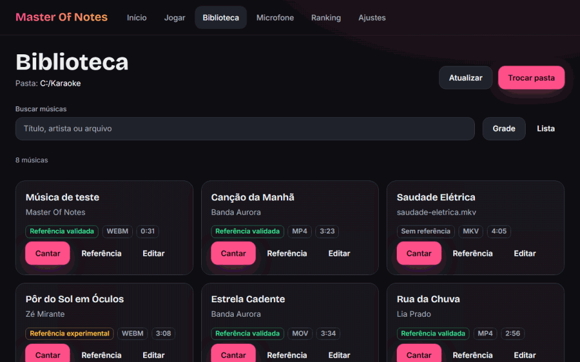
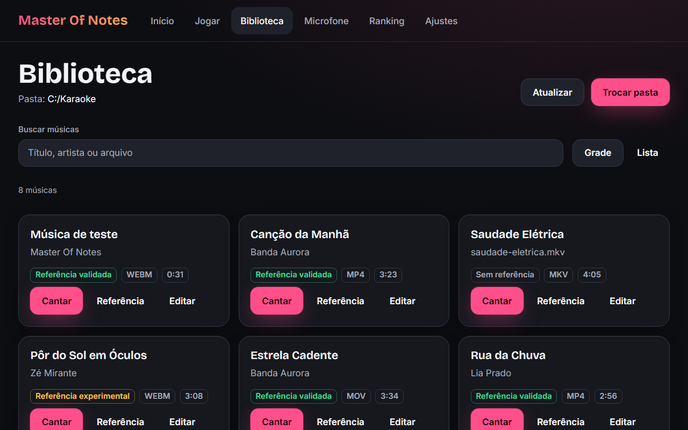
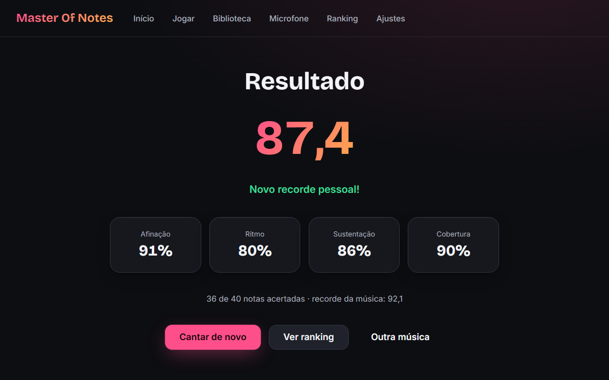
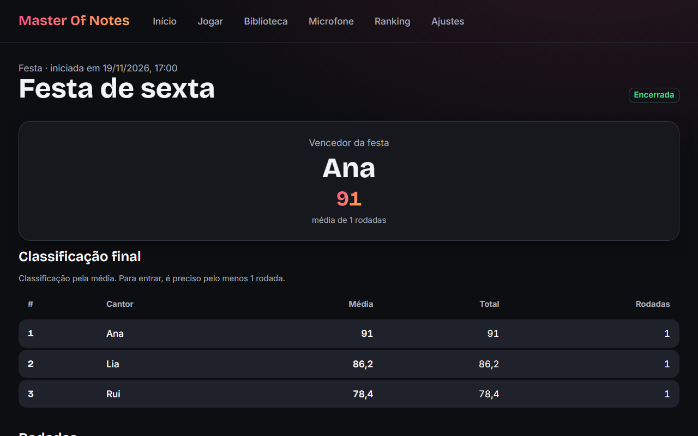

<div align="center">

# 🎤 Master Of Notes

**Karaokê para Windows que dá nota à sua voz de verdade: nota por nota, comparando o que você canta com a melodia da música.**

Use os seus próprios vídeos de karaokê. Funciona sem internet e sem conta.

[](https://github.com/Chamfrado/MasterOfNotes/releases)


[](https://github.com/Chamfrado/MasterOfNotes/actions/workflows/ci.yml)

### [⬇️ Baixar para Windows](https://github.com/Chamfrado/MasterOfNotes/releases) · [📖 Guia do usuário](docs/user/README.md) · [❓ Problemas e FAQ](docs/user/13-problemas-e-faq.md)



</div>

> **Versão de testes (pré-release).** A [v0.1.1](https://github.com/Chamfrado/MasterOfNotes/releases/tag/v0.1.1) é a primeira versão pública. A pontuação foi calibrada e auditada com testes automáticos; a validação com vozes reais está em andamento, e a regra da nota pode ser ajustada nas próximas versões.

---

## ✨ O que ele faz

| | |
|---|---|
| 🎵 **Sua biblioteca, automática** | Escolha uma pasta com vídeos (MP4, WEBM, MOV, MKV) e o app monta o catálogo, com busca e atualização sozinha quando você adiciona ou remove arquivos. Os vídeos ficam onde estão. |
| 🎯 **Nota de verdade** | Não é volume nem sorteio: o app detecta a nota que você canta e compara com a [melodia de referência](docs/user/05-referencia-melodica.md) (afinação, ritmo e sustentação). Vibrato e enfeites naturais não tiram ponto. |
| 📊 **Feedback ao vivo** | Um painel discreto mostra a nota cantada, se está afinado e a pontuação parcial, sem cobrir a letra do vídeo. |
| 🎉 **Modos para festa** | **Solo**, **Festa** (classificação pela média, para ser justa com quem cantou menos), **Duelo** e **Desafio**, com participantes locais e retomada de partida. |
| 🏆 **Rankings e recordes** | Ranking por música e dificuldade, histórico de apresentações e recorde pessoal. |
| 🎙️ **Microfone sob controle** | Calibração de ruído, medição de latência e teste de vazamento (garante que o app ouve você, e não a música das caixas). |
| 📺 **Pronto para a TV** | Modo TV com letras e botões maiores e navegação pelas setas (funciona com controle remoto). |
| 🔒 **Privado** | O áudio do microfone é analisado na hora e **nunca é gravado**. Nada sai do seu computador. |

<table>
<tr>
<td width="33%"></td>
<td width="33%"></td>
<td width="33%"></td>
</tr>
<tr>
<td align="center"><sub>Biblioteca</sub></td>
<td align="center"><sub>Resultado</sub></td>
<td align="center"><sub>Festa</sub></td>
</tr>
</table>

<sub>As músicas, artistas, cantores e notas das imagens são exemplos ilustrativos.</sub>

---

## 🚀 Comece em 5 passos

1. **[Instale](docs/user/01-instalacao.md):** baixe o `…_x64-setup.exe` da [página de versões](https://github.com/Chamfrado/MasterOfNotes/releases) e execute. Não pede senha de administrador.
2. **[Escolha a pasta de músicas](docs/user/03-biblioteca.md)** em **Biblioteca → Escolher pasta**.
3. **[Configure o microfone](docs/user/04-microfone.md):** escolha o dispositivo, calibre o ruído e faça o teste de vazamento (de preferência com fones de ouvido).
4. **[Importe a referência melódica](docs/user/05-referencia-melodica.md)** da música (arquivo MIDI ou JSON) e valide o alinhamento. É ela que permite dar nota.
5. **[Cante!](docs/user/06-cantar.md)** Clique em **Cantar**, espere o 3-2-1 e solte a voz.

> Sem referência melódica a música toca normalmente e você pode cantar, mas a apresentação vale como **treino** (sem nota no ranking).

---

## 🎯 Como a nota é calculada (resumo)

**Nota = 65% afinação + 20% ritmo + 15% sustentação**, de 0 a 100, ponderada pela duração de cada nota.

- Cantar uma **oitava** acima ou abaixo vale igual (vozes graves e agudas competem de igual para igual).
- **Volume não conta.** Trechos instrumentais não tiram ponto. Nota que você não canta conta zero.
- Três dificuldades (**Fácil**, **Normal**, **Difícil**) mudam a tolerância de afinação.
- Notas de versões diferentes do cálculo ou da referência **não se misturam** no ranking.

Detalhes, exemplos e limites: [Como a pontuação funciona](docs/user/07-pontuacao.md).

---

## 📖 Guia do usuário

| | |
|---|---|
| 1. [Instalação e desinstalação](docs/user/01-instalacao.md) | 8. [Modos de jogo](docs/user/08-modos-de-jogo.md) |
| 2. [Primeira execução](docs/user/02-primeira-execucao.md) | 9. [Ranking e histórico](docs/user/09-ranking-e-historico.md) |
| 3. [Biblioteca de músicas](docs/user/03-biblioteca.md) | 10. [Ajustes e Modo TV](docs/user/10-ajustes-e-modo-tv.md) |
| 4. [Microfone](docs/user/04-microfone.md) | 11. [Atualizações](docs/user/11-atualizacoes.md) |
| 5. [Referência melódica](docs/user/05-referencia-melodica.md) | 12. [Privacidade](docs/user/12-privacidade.md) |
| 6. [Cantar](docs/user/06-cantar.md) | 13. [Problemas e FAQ](docs/user/13-problemas-e-faq.md) |
| 7. [Como a pontuação funciona](docs/user/07-pontuacao.md) | 14. [Glossário](docs/user/14-glossario.md) |

---

## 💻 Requisitos

- Windows 10 ou 11, 64 bits (testado no Windows 11)
- Microsoft Edge WebView2 (já vem no Windows 11)
- Um microfone; **fones de ouvido** recomendados
- Seus vídeos de karaokê e, para pontuar, a referência melódica de cada música (MIDI ou JSON)

## 🐞 Encontrou um problema?

Veja [Problemas e FAQ](docs/user/13-problemas-e-faq.md) ou [abra uma issue](https://github.com/Chamfrado/MasterOfNotes/issues).

## ⚖️ Conteúdo de terceiros

O app não inclui músicas, vídeos, letras nem referências de terceiros. Você é responsável pelos direitos do conteúdo que usa.

---

<details>
<summary><b>🛠️ Para desenvolvedores</b></summary>

Tauri 2 + React/TypeScript + Rust. Captura e análise de voz em Rust (YIN), pontuação determinística e versionada, SQLite local.

**Requisitos (Windows):** Node 22+, pnpm 10, Rust stable (MSVC), Visual Studio Build Tools, WebView2.

```sh
pnpm install
pnpm dev      # abre o app em modo de desenvolvimento
pnpm check    # tipos, testes TS, fmt, clippy e testes Rust
pnpm build    # gera o instalador
```

Documentação técnica: [AGENTS.md](AGENTS.md) · [leis do projeto](docs/project-laws.md) · [arquitetura](docs/architecture/overview.md) · [specs](specs/README.md) · [roadmap](docs/roadmap.md) · [CHANGELOG](CHANGELOG.md)

</details>
