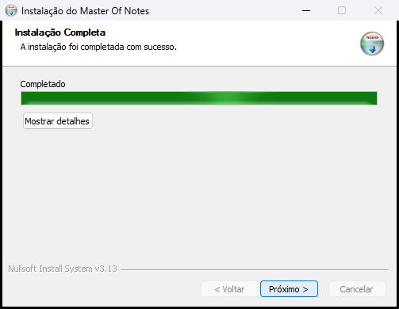

# 1. Instalação e desinstalação

[← Índice](README.md) · [Próximo: Primeira execução →](02-primeira-execucao.md)

## O que você precisa

- **Windows 64 bits.** O app foi testado no Windows 11.
- **Microsoft Edge WebView2**, o componente do Windows que desenha a tela do app. No Windows 11 ele já vem instalado.
- **Um microfone.** Pode ser o do notebook, um headset ou um microfone USB.
- **Fones de ouvido (recomendado).** Sem fones, o microfone pode captar a música que sai das caixas de som, e aí a partida não vale ranking. Veja [Teste de vazamento](04-microfone.md#teste-de-vazamento).
- **Seus vídeos de karaokê** numa pasta do computador. O app não vem com músicas.

Não precisa de internet para usar o app nem de conta ou cadastro.

## Instalar

> **Sobre a pontuação.** A pontuação foi validada com testes automáticos. A validação com vozes reais de pessoas ainda está em andamento, então a nota pode ser ajustada em versões futuras (veja [Como a pontuação funciona](07-pontuacao.md#até-onde-dá-para-confiar)).

1. Abra a página da versão mais recente: <https://github.com/Chamfrado/MasterOfNotes/releases/latest>. Todas as versões ficam em <https://github.com/Chamfrado/MasterOfNotes/releases>.
2. Em **Assets**, baixe o arquivo **`Master.Of.Notes_0.1.2_x64-setup.exe`** (cerca de 4 MB). Em versões futuras, o número muda, mas o nome continua terminando em **`_x64-setup.exe`**. Os outros arquivos da lista (`.sig`, `latest.json` e o código-fonte) servem para as atualizações automáticas e para desenvolvedores; você não precisa deles.
3. Dê dois cliques no arquivo baixado.
4. O Windows deve mostrar o aviso **"O Windows protegeu o computador"**. Clique em **Mais informações** e depois em **Executar assim mesmo**.
5. O instalador abre em português, na tela **Bem-vindo ao Instalador do Master Of Notes**. Clique em **Próximo >** e siga as telas até o fim.
6. Quando aparecer **Instalação Completa — A instalação foi completada com sucesso**, clique em **Próximo >** para ir à última tela e concluir. Ao terminar, o instalador pode abrir o app.

> **Por que aparece esse aviso?** O Windows avisa sempre que um instalador não tem um certificado comercial de assinatura de código, que é pago. O Master Of Notes não tem esse certificado, então o aviso é esperado. Para instalar com segurança, **baixe o instalador só da página oficial de versões** (o endereço acima), nunca de outros sites ou de arquivos repassados por outras pessoas. Depois de instalado, as [atualizações](11-atualizacoes.md) do próprio app são conferidas por uma assinatura digital do projeto, e uma atualização adulterada é recusada.

<!-- A capturar (próxima versão ou captura do proprietário): media/instalador-boas-vindas.png — primeira tela do instalador, em pt-BR. -->

*Captura real do instalador (versão 0.1.1; nas versões seguintes, as telas são as mesmas).*

A instalação é **só para o seu usuário do Windows**: não pede senha de administrador. Ao terminar, aparecem atalhos do **Master Of Notes** no menu Iniciar e na Área de Trabalho.

### Onde as coisas ficam

| O quê | Onde |
|---|---|
| O programa (com o aviso de componentes de terceiros, `THIRD-PARTY-NOTICES.txt`) | `%LOCALAPPDATA%\Master Of Notes\` |
| Seus dados (biblioteca, cantores, pontuações, ajustes) | `%APPDATA%\com.masterofnotes.karaoke\` |
| Seus vídeos | Continuam na pasta onde você os guardou. O app não copia nem move nada. |

Para abrir uma dessas pastas, cole o caminho na barra de endereço do Explorador de Arquivos.

### Componente de terceiros

A partir da versão 0.1.3, o instalador traz também o **ONNX Runtime**, da Microsoft (licença MIT). É ele que roda o modelo de separação de voz da [referência automática](05-referencia-melodica.md#gerar-automaticamente-a-partir-do-vídeo). O aviso da licença está no arquivo `THIRD-PARTY-NOTICES.txt`, na pasta do programa. O modelo de separação em si **não** vem no instalador: quem o baixa é você.

## Atualizar

Quando sair uma versão nova, o próprio app pode instalá-la. Veja [Atualizações](11-atualizacoes.md). Seus dados são mantidos.

## Desinstalar

1. Abra **Configurações do Windows → Aplicativos → Aplicativos instalados**.
2. Procure **Master Of Notes**, clique em **⋯** e em **Desinstalar**.

<!-- A capturar (só a tela "Aplicativos instalados" filtrada, sem desinstalar e com novo OK do coordenador): media/desinstalar-windows.png. -->

O desinstalador remove o programa e os atalhos. **Seus dados ficam guardados** em `%APPDATA%\com.masterofnotes.karaoke\`, para o caso de você instalar de novo. Se quiser apagar tudo, apague essa pasta depois de desinstalar. Isso remove seus rankings, cantores e ajustes de forma definitiva. Seus vídeos não são tocados.

---

[← Índice](README.md) · [Próximo: Primeira execução →](02-primeira-execucao.md)
