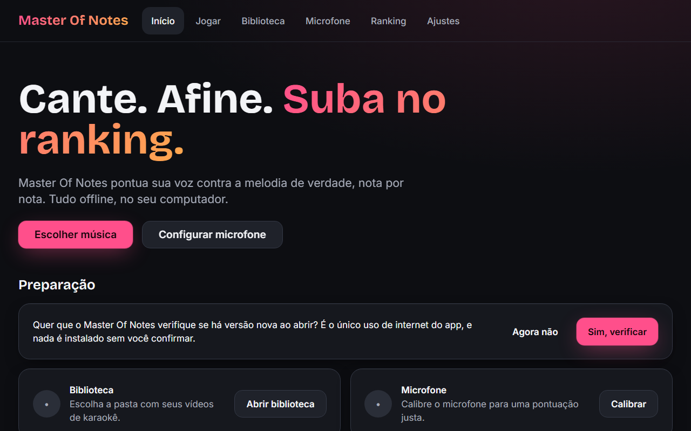
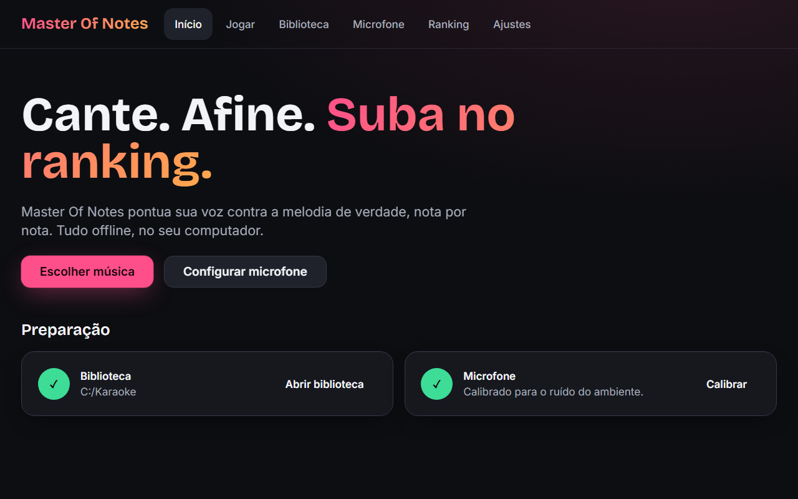

# 2. Primeira execução

[← Instalação](01-instalacao.md) · [Índice](README.md) · [Próximo: Biblioteca →](03-biblioteca.md)

Abra o **Master Of Notes** pelo menu Iniciar ou pelo atalho da Área de Trabalho. A primeira tela é o **Início**.

## O menu do topo

| Item | Para que serve |
|---|---|
| **Início** | Volta para esta tela e mostra o que falta preparar. |
| **Jogar** | Partidas com várias pessoas e desafios. Veja [Modos de jogo](08-modos-de-jogo.md). |
| **Biblioteca** | Suas músicas. Veja [Biblioteca](03-biblioteca.md). |
| **Microfone** | Escolher, testar e calibrar o microfone. Veja [Microfone](04-microfone.md). |
| **Ranking** | As melhores notas de cada música. Veja [Ranking e histórico](09-ranking-e-historico.md). |
| **Ajustes** | Dificuldade, Modo TV e outras opções. Veja [Ajustes](10-ajustes-e-modo-tv.md). |

Para voltar à tela anterior, aperte **Esc**.

## A pergunta sobre atualizações

Na primeira vez, o Início pergunta: *"Quer que o Master Of Notes verifique se há versão nova ao abrir?"*

- **Sim, verificar**: toda vez que você abrir o app, ele consulta a internet para ver se há versão nova. Se houver, só avisa. Nada é instalado sem você confirmar.
- **Agora não**: o app nunca acessa a internet sozinho. Você ainda pode procurar atualizações quando quiser, em **Ajustes → Verificar agora**.

A pergunta aparece uma vez só. Para mudar de ideia depois, use a opção **Verificar atualizações ao abrir** em [Ajustes](10-ajustes-e-modo-tv.md).

## Preparação: os dois passos

Na seção **Preparação**, o Início mostra o que falta fazer antes de cantar:

1. **Biblioteca**: escolher a pasta com seus vídeos de karaokê. Botão **Abrir biblioteca**.
2. **Microfone**: calibrar o microfone para o ruído do ambiente. Botão **Calibrar**.

Quando um passo está pronto, ele ganha um ✓ verde. Na Biblioteca aparece o caminho da pasta; no Microfone, *"Calibrado para o ruído do ambiente."*

Os atalhos **Escolher música** e **Configurar microfone**, no alto da tela, levam aos mesmos lugares.

Depois desses dois passos, falta uma coisa para a pontuação valer: a [referência melódica](05-referencia-melodica.md) de cada música.

---

[← Instalação](01-instalacao.md) · [Índice](README.md) · [Próximo: Biblioteca →](03-biblioteca.md)
