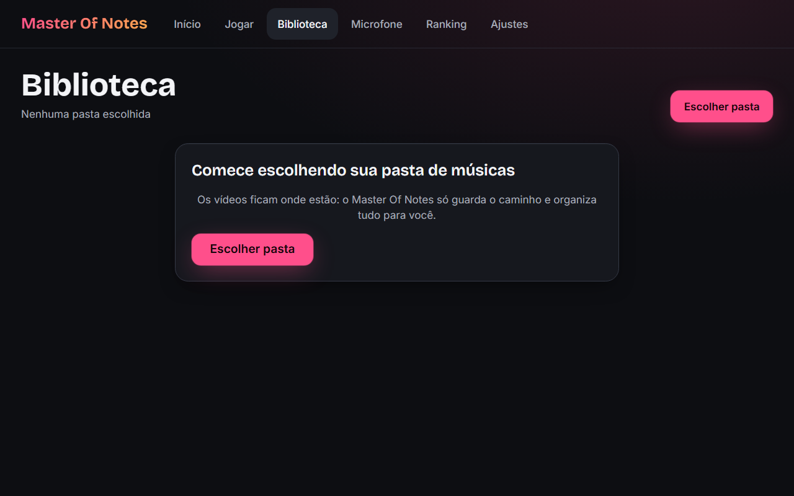
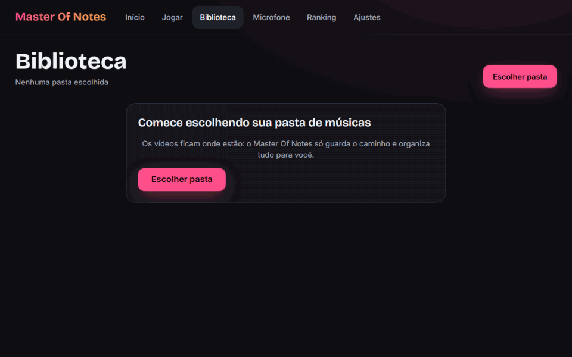
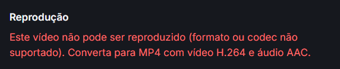
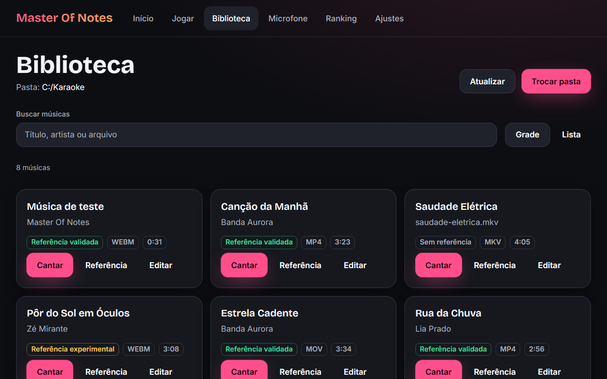
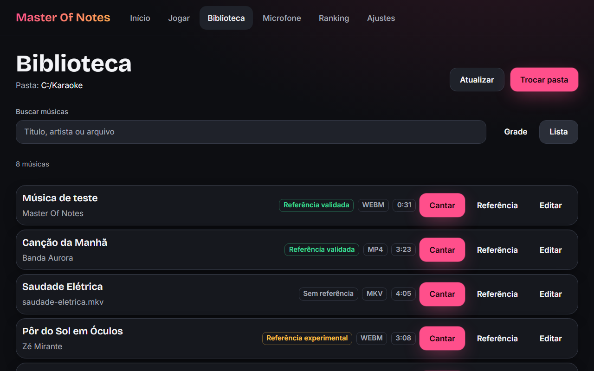
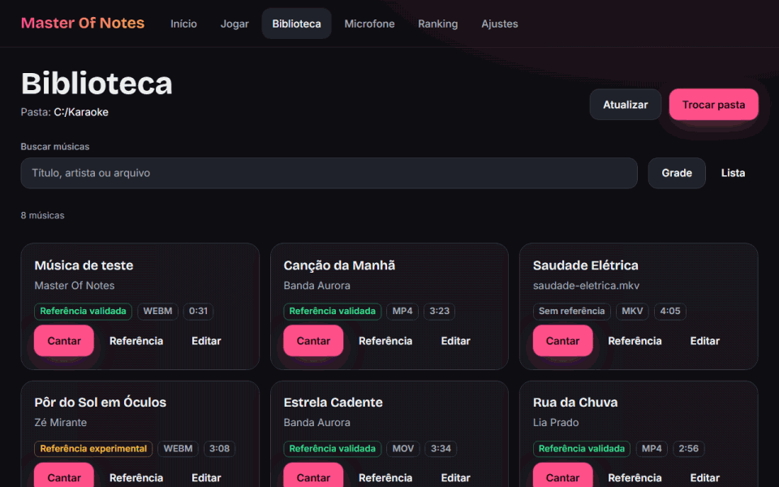
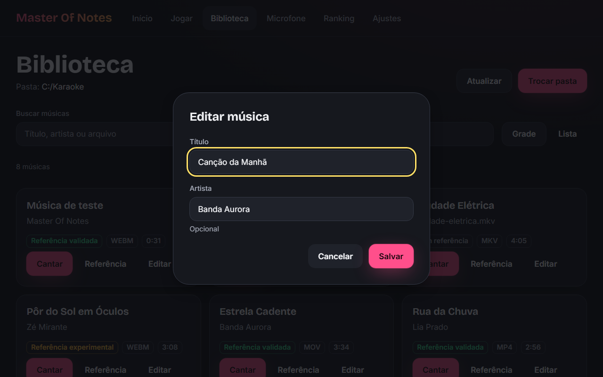

# 3. Biblioteca de músicas

[← Primeira execução](02-primeira-execucao.md) · [Índice](README.md) · [Próximo: Microfone →](04-microfone.md)

A Biblioteca lista os vídeos de karaokê de uma pasta do seu computador. O Master Of Notes **não copia nem move** os vídeos: guarda só o caminho e organiza a lista para você.

## Escolher a pasta

1. Clique em **Biblioteca** no menu.
2. Clique em **Escolher pasta**.
3. Na janela do Windows, selecione a pasta onde estão os vídeos e confirme.
4. O app mostra *"Procurando vídeos…"* e, ao terminar, avisa quantas músicas encontrou, por exemplo *"8 músicas encontradas (8 novas, 0 removidas)"*.

Depois disso:

- **Atualizar** procura de novo na mesma pasta. Use se você adicionou ou apagou vídeos e a lista não mudou sozinha. Normalmente ela se atualiza sozinha enquanto o app está aberto.
- **Trocar pasta** escolhe outra pasta. As músicas da pasta antiga saem da lista; os rankings delas continuam guardados.
- Em [Ajustes](10-ajustes-e-modo-tv.md), a opção **Procurar também nas subpastas** decide se as pastas de dentro da pasta escolhida entram na busca. Ela vale a partir da próxima atualização da biblioteca.

## Formatos de vídeo

A Biblioteca aceita arquivos **MP4, MKV, WEBM, MOV e AVI**. Mas aceitar o arquivo não garante que ele toque: quem toca o vídeo é o componente de vídeo do Windows (WebView2), e ele não abre todo tipo de compressão.

- **O formato mais seguro é MP4 com vídeo H.264 e áudio AAC.**
- MKV e AVI muitas vezes usam compressões que o Windows não toca dentro do app.
- O app só sabe se um vídeo toca na primeira vez que você tenta cantá-lo. Antes disso, a tela da música diz *"Ainda não verificado: confirmamos na primeira vez que tocar."*

Se um vídeo não tocar, ele ganha o selo **Formato incompatível**, o botão **Cantar** fica desativado e a tela da música mostra:

**O que fazer:** converta o arquivo para MP4 (H.264 + AAC) com um conversor de vídeo de sua escolha, por exemplo o HandBrake, que é gratuito. Salve o arquivo convertido na pasta da biblioteca. Ele aparece como uma música nova.

## A lista de músicas

Cada música mostra:

- **Título** e **artista**. Se o artista não foi informado, aparece o nome do arquivo.
- **Selo da referência melódica**: sem a referência não há pontuação. Veja [Referência melódica](05-referencia-melodica.md).

  | Selo | Significa |
  |---|---|
  | **Sem referência** | Ainda não tem a melodia. Dá para cantar, mas sem nota. |
  | **Referência experimental** | Tem a melodia, mas o alinhamento ainda não foi conferido. Partidas viram treino. |
  | **Referência validada** | Pronta para competir e entrar no ranking. |
  | **Referência inválida** | Alguém marcou a referência como errada. Importe outra. |

- **Formato** (MP4, MKV…) e **duração**. A duração aparece depois que o vídeo toca pela primeira vez.
- Botões **Cantar** (abre o player), **Referência** (abre a referência melódica) e **Editar** (muda título e artista).

Para ver detalhes, clique no **título** da música.

### Grade ou lista

Use **Grade** ou **Lista**, ao lado da busca, para mudar a forma de exibir.

### Buscar

Digite no campo **Buscar músicas**. A busca procura no título, no artista e no nome do arquivo, e **ignora acentos e maiúsculas**: "cancao" encontra "Canção da Manhã".

### Editar título e artista

Os nomes vêm do arquivo e nem sempre estão certos. Clique em **Editar**, corrija **Título** e **Artista** (opcional) e clique em **Salvar**. O arquivo no disco não muda.

## Tela da música (detalhes)

Clique no título de uma música para abrir a tela dela.

*Nomes e pontuações da imagem são exemplos ilustrativos.*

- **Informações**: corrija título e artista e clique em **Salvar alterações**. Abaixo, o nome do arquivo, o formato, a duração e o tamanho.
- **Reprodução**: se o vídeo abre neste computador.
- **Referência melódica**: a situação da referência e o botão **Importar referência** (ou **Abrir referência**, se já existir uma).
- **Recordes**: as 5 melhores notas da música na dificuldade atual. Em **Recorde pessoal de**, escolha um cantor para ver a melhor nota dele.
- **Suas apresentações**: as últimas 10 vezes que alguém cantou esta música. O selo **Treino** marca as que não valeram ranking, e **Versão anterior** marca as que foram pontuadas com outra versão da referência ou do cálculo (veja [Ranking e histórico](09-ranking-e-historico.md#versão-anterior)).
- No topo: **Ranking completo** e **Cantar**.

---

[← Primeira execução](02-primeira-execucao.md) · [Índice](README.md) · [Próximo: Microfone →](04-microfone.md)
