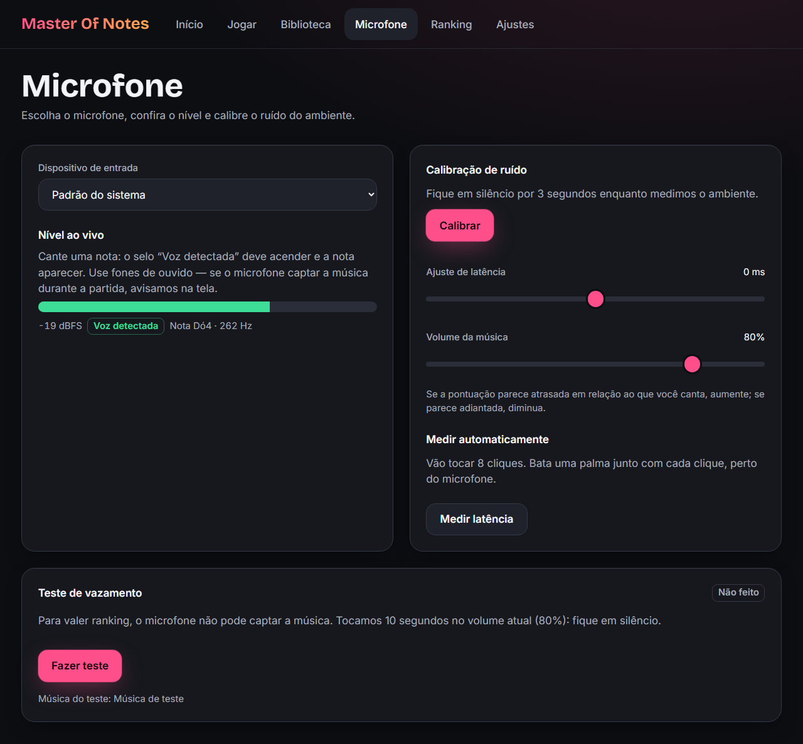
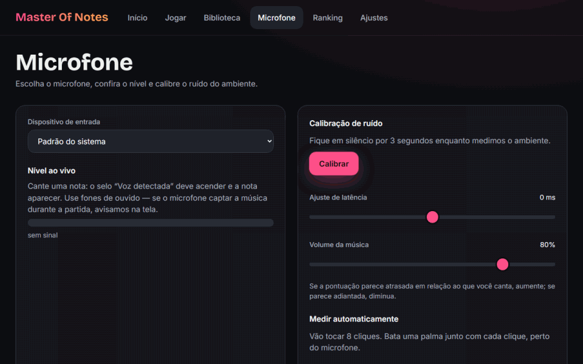
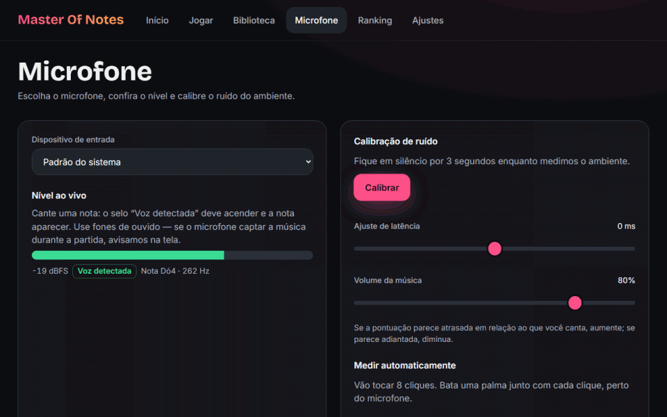
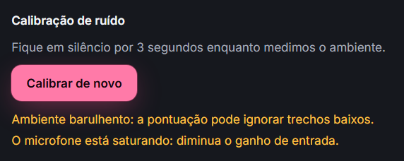
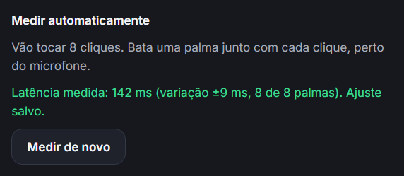
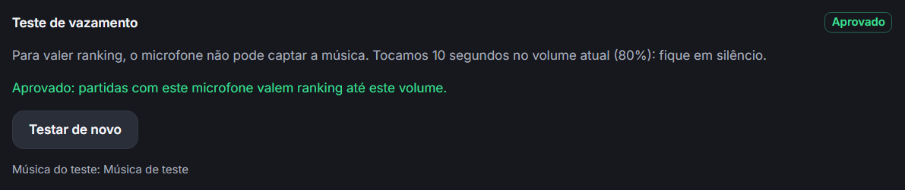
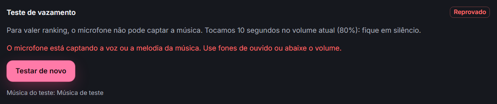

# 4. Microfone

[← Biblioteca](03-biblioteca.md) · [Índice](README.md) · [Próximo: Referência melódica →](05-referencia-melodica.md)

A tela **Microfone** prepara o que a pontuação precisa ouvir: o microfone certo, o nível de entrada, o ruído do ambiente, o atraso do som e se o microfone está captando a música.

*Os níveis e a nota da imagem são ilustrativos.*

Faça nesta ordem na primeira vez: **dispositivo → nível → calibração → teste de vazamento**. A latência só precisa de ajuste se a nota parecer atrasada ou adiantada.

> **Seu áudio não é gravado.** O app analisa o som do microfone na hora para calcular a nota e descarta o áudio. Veja [Privacidade](12-privacidade.md).

## 1. Dispositivo de entrada

Em **Dispositivo de entrada**, escolha o microfone. **Padrão do sistema** usa o microfone padrão do Windows. O padrão do Windows também aparece na lista com *(padrão)* no nome.

Se aparecer *"Nenhum microfone encontrado. Conecte um e volte a esta tela."*, conecte o microfone e abra a tela de novo.

## 2. Nível ao vivo

Cante uma nota. A barra deve subir, o selo **Voz detectada** deve acender e a nota que você cantou aparece ao lado (por exemplo, *Nota Dó4 · 262 Hz*). O número depois do nome é a oitava: Dó4 é o Dó do meio do piano. Veja o [glossário](14-glossario.md#nome-das-notas).

*Animação com níveis ilustrativos.*

- A barra fica **verde** quando há voz, **vermelha** quando o sinal satura (aparece o aviso **Saturando — afaste o microfone**).
- Depois de calibrar, uma linha fina na barra marca o nível do ruído do ambiente. Sua voz precisa passar dessa linha para ser ouvida.

## 3. Calibração de ruído

Mede o barulho do ambiente para separar a sua voz do fundo.

1. Fique em silêncio.
2. Clique em **Calibrar** (ou **Calibrar de novo**).
3. Espere 3 segundos sem falar. O botão mostra *"Medindo… silêncio, por favor"*.

Resultados possíveis:

| Mensagem | O que fazer |
|---|---|
| *Ambiente bom para cantar.* | Nada. |
| *Ambiente barulhento: a pontuação pode ignorar trechos baixos.* | Feche janelas, desligue ventiladores ou cante mais perto do microfone. |
| *Sinal muito baixo: aproxime o microfone ou aumente o ganho.* | Aproxime o microfone ou aumente o volume de entrada nas configurações de som do Windows. |
| *O microfone está saturando: diminua o ganho de entrada.* | Afaste o microfone ou diminua o volume de entrada no Windows. |

Calibre de novo se trocar de microfone ou de ambiente.

## 4. Volume da música

**Volume da música** é o volume do vídeo no player (também dá para mudar durante a música). Ele importa para o [teste de vazamento](#teste-de-vazamento): o teste aprova um volume, e subir acima dele exige testar de novo.

## 5. Latência (atraso)

Entre você cantar e o app ouvir, e entre o vídeo tocar e o som sair, existe um pequeno atraso: a **latência**. Se ela não for compensada, o app compara sua voz com a nota errada e a pontuação de ritmo cai.

### Medir automaticamente (recomendado)

1. Deixe o volume num nível em que você ouça bem.
2. Clique em **Medir latência**.
3. Vão tocar **8 cliques**. **Bata uma palma junto com cada clique**, perto do microfone.
4. Ao final, o app mostra o atraso medido e salva o ajuste sozinho.

*Valores ilustrativos.*

Se não der certo, o ajuste anterior é mantido e aparece o motivo:

| Mensagem | O que fazer |
|---|---|
| *Não detectamos os cliques ou as palmas. Aumente o volume ou bata palmas mais forte.* | Suba o volume, bata palmas mais forte e mais perto do microfone. |
| *A latência medida ficou fora da faixa de −500 a +500 ms. Repita a sonda.* | Repita, batendo as palmas no tempo dos cliques. |
| *Sonda curta demais: deixe todos os cliques tocarem.* | Repita sem sair da tela. |

### Ajustar à mão

Use o controle **Ajuste de latência** (de −500 a +500 ms). A regra: *se a pontuação parece atrasada em relação ao que você canta, aumente; se parece adiantada, diminua.*

## Teste de vazamento

Para uma partida **valer ranking**, o microfone **não pode captar a música** que sai das caixas de som. Se captar, o app poderia dar pontos para a voz-guia do vídeo em vez de para você. O teste confere isso.

1. Use fones de ouvido, se tiver.
2. Clique em **Fazer teste** (ou **Testar de novo**).
3. O app toca **10 segundos** de uma música da sua biblioteca, no volume atual. **Fique em silêncio.**

O teste usa uma música que tenha referência melódica (de preferência validada). Se nenhuma tiver, aparece *"Importe uma referência melódica em alguma música da biblioteca para fazer o teste."* Veja [Referência melódica](05-referencia-melodica.md).

| Selo | Significa |
|---|---|
| **Não feito** | O teste ainda não foi feito. |
| **Aprovado** | Partidas com este microfone valem ranking até este volume. |
| **Reprovado** | O microfone captou a música. |
| **Refazer (microfone ou volume mudou)** | Você trocou de microfone ou subiu o volume da música acima do volume testado. Baixar o volume não exige refazer. |

Se reprovar: **use fones de ouvido** ou **baixe o volume da música** e teste de novo. Enquanto o teste não estiver aprovado, você ainda pode cantar, mas como **treino** (fora do ranking).

---

[← Biblioteca](03-biblioteca.md) · [Índice](README.md) · [Próximo: Referência melódica →](05-referencia-melodica.md)
