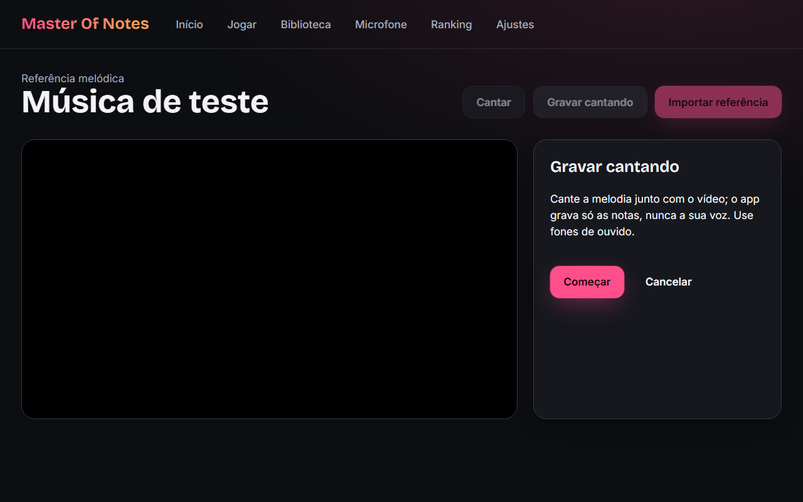

# 5. Referência melódica

[← Microfone](04-microfone.md) · [Índice](README.md) · [Próximo: Cantar →](06-cantar.md)

## O que é e por que é necessária

O vídeo de karaokê tem imagem, música e letra, mas **não diz ao computador quais notas devem ser cantadas**. A **referência melódica** é essa lista de notas: qual nota, quando começa e quanto dura. É contra ela que o Master Of Notes compara a sua voz.

- **Sem referência, não há pontuação.** Você pode cantar, mas o resultado mostra só métricas de treino (veja [Cantar](06-cantar.md#resultado)).
- O app **não descobre** a melodia sozinho a partir do vídeo. Ela vem de um arquivo ou de alguém que a cante.

## De onde tirar a referência

Há dois caminhos:

| Caminho | Quando usar | Selo da fonte |
|---|---|---|
| **Importar um arquivo** MIDI ou JSON | Quando você tem o arquivo da melodia. É o caminho **mais preciso**: as notas foram escritas uma a uma. | **MIDI** ou **JSON** |
| **[Gravar cantando](#gravar-cantando)** | Quando você **não tem** o arquivo. Alguém que conhece bem a música canta a melodia junto com o vídeo e o app anota as notas. | **Cantada** |

Os arquivos aceitos:

- **MIDI** (`.mid` ou `.midi`): o formato mais comum de arquivos de música "por notas". Um MIDI costuma ter várias trilhas (bateria, baixo, voz…); você escolhe qual é a da voz.
- **JSON no formato `mon-melody v1`**: o formato próprio do Master Of Notes, uma lista de notas em texto.

Use arquivos que você tenha o direito de usar. O app não vem com referências de músicas.

## Importar

1. Na [Biblioteca](03-biblioteca.md), clique em **Referência** na música (ou, na tela da música, em **Importar referência**).
2. Clique em **Importar referência**.
3. Escolha o arquivo `.mid`, `.midi` ou `.json`.

### Escolher a trilha da voz (MIDI)

Se o MIDI tiver mais de uma trilha com notas, o app pergunta **Qual trilha é a voz?** e mostra o nome e o número de notas de cada uma. Escolha a da melodia cantada; ela costuma se chamar "Voz", "Vocal", "Melody" ou o nome do cantor. Trilhas sem nome aparecem como *Trilha 1*, *Trilha 2*…

*Nomes de trilha de exemplo.*

Ao importar, a referência entra como **Referência experimental**: o app ainda não sabe se ela está alinhada com o seu vídeo.

## Gravar cantando

Sem o arquivo da melodia, dá para criar a referência **cantando**. A pessoa que grava canta a melodia junto com o vídeo, e o app anota cada nota: qual é, quando começa e quanto dura.

**A referência fica tão boa quanto quem cantou.** As notas gravadas viram o gabarito com que todo mundo vai ser comparado depois. Por isso:

- **Quem grava deve conhecer bem a melodia e cantar afinado.** Se errar uma nota na gravação, quem cantar certo depois perde ponto nessa nota.
- **Cante a melodia do cantor original**, sem enfeites nem improviso, e no tempo do vídeo.
- **Use fones de ouvido.** Sem fones, o microfone capta a música das caixas de som e o app pode anotar notas dos instrumentos.
- Prepare o [microfone](04-microfone.md) antes: dispositivo certo, calibração de ruído e latência.

**O app guarda só as notas, nunca a sua voz.** O som do microfone é analisado na hora e descartado, como no resto do app (veja [Privacidade](12-privacidade.md)).

### Passo a passo

1. Na tela da referência, clique em **Gravar cantando**.
2. Leia o painel **Gravar cantando** e clique em **Começar**.

   

3. Depois da contagem **3, 2, 1**, o vídeo toca do início. Enquanto o selo **Gravando notas** estiver aceso, cante a melodia. O medidor mostra que o microfone está ouvindo você.
4. Ao fim da música, a gravação para sozinha. Para terminar antes, clique em **Parar**.
5. O app mostra *"Salvando as notas…"* e volta para a tela da referência, com as notas desenhadas sobre o vídeo e os selos **Cantada** e **Referência experimental**.

*Notas e nível do microfone de exemplo.*

**Cancelar** descarta a gravação e não muda nada.

Se a música já tinha referência, o painel avisa: *"A referência atual fica no histórico; a nova nasce experimental."* A referência anterior não é apagada, mas deixa de ser a usada nas partidas.

Se o app detectar **menos de 3 notas** (microfone mudo, voz baixa demais, silêncio), nada é salvo: aparece o motivo e o botão **Gravar de novo**.

### Depois de gravar: revise e valide

Uma referência cantada entra como **experimental**, igual a um arquivo importado. Antes de valer ranking:

1. Dê play e confira as notas sobre o vídeo, como em [Alinhar com o vídeo](#alinhar-com-o-vídeo). Se as barras estiverem todas adiantadas ou atrasadas, ajuste o offset.
2. Se as notas estiverem erradas (nota fora da melodia, trecho faltando), grave de novo: quando a referência ativa é cantada, o botão se chama **Gravar de novo**.
3. Quando estiver tudo certo, clique em **Validar alinhamento**. Veja [Validar](#validar).

## Alinhar com o vídeo

O MIDI e o vídeo raramente começam no mesmo instante. Às vezes o vídeo tem uma introdução mais longa, por exemplo. Por isso, confira o alinhamento:

1. Na tela da referência, dê play no vídeo. As **notas da referência aparecem desenhadas por cima do vídeo**: cada barra é uma nota (mais alta na tela = nota mais aguda), e a linha branca vertical marca o instante atual. A nota que está tocando agora fica **amarela**.
2. Compare com a voz do vídeo (ou com a letra destacada). Se as barras chegam **antes** da voz, aumente o offset. Se chegam **depois**, diminua.
3. Ajuste com o controle **Offset das notas** (até ±10 segundos) ou com os botões **−100 ms**, **−10 ms**, **+10 ms** e **+100 ms**. *Positivo atrasa as notas; negativo adianta.*
4. Clique em **Salvar offset**. Para voltar ao valor salvo, use **Desfazer**.

Salvar um novo offset volta a referência para **experimental**, porque o alinhamento mudou e precisa ser conferido de novo.

## Validar

Quando as notas acompanharem a voz do vídeo, clique em **Validar alinhamento**. A referência passa a **Referência validada** e as partidas dessa música **valem ranking** (desde que o [teste de vazamento](04-microfone.md#teste-de-vazamento) esteja aprovado).

Se você salvou o offset e ainda não validou, aparece *"Salve o offset antes de validar."*

Se a referência estiver errada (trilha errada, música diferente), clique em **Marcar inválida**. Partidas com referência inválida viram treino até você importar outra com **Importar outra** ou [gravar cantando](#gravar-cantando).

## Experimental x validada

| | Experimental | Validada |
|---|---|---|
| Dá para cantar? | Sim | Sim |
| Mostra pontuação? | Sim | Sim |
| Vale ranking? | **Não** (treino) | **Sim** |
| Aparece em Festa, Duelo e Desafio? | Não | Sim |

Importar outra referência (ou gravar cantando) cria uma referência nova, e salvar um novo offset aumenta a **revisão** (o selo *Revisão N*). A referência anterior fica guardada no histórico. Notas feitas com uma referência ou revisão antiga ficam no histórico como **Versão anterior** e não se misturam com o ranking atual. Veja [Ranking e histórico](09-ranking-e-historico.md#versão-anterior).

---

[← Microfone](04-microfone.md) · [Índice](README.md) · [Próximo: Cantar →](06-cantar.md)
