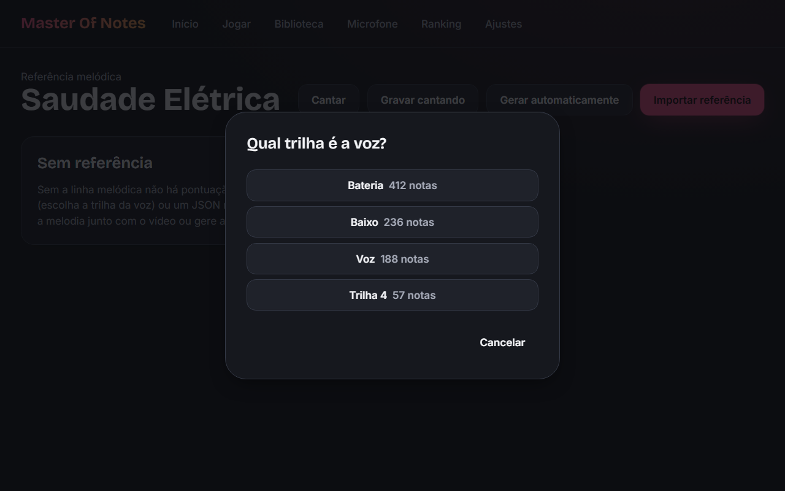
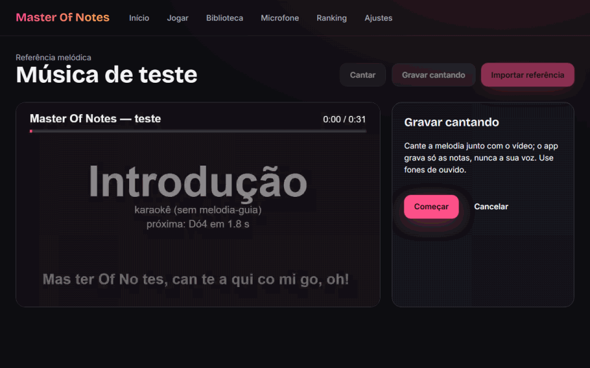
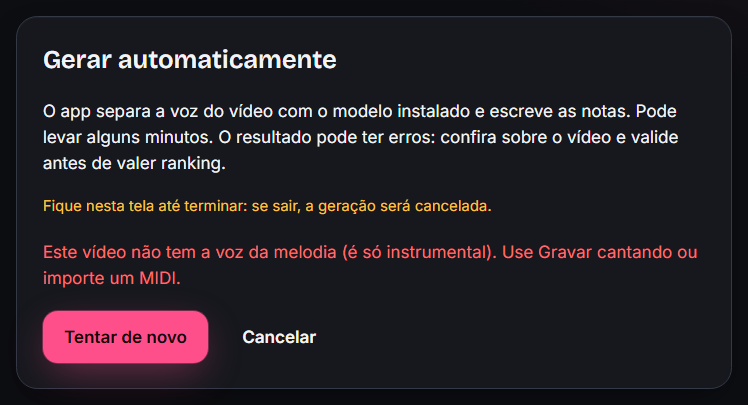
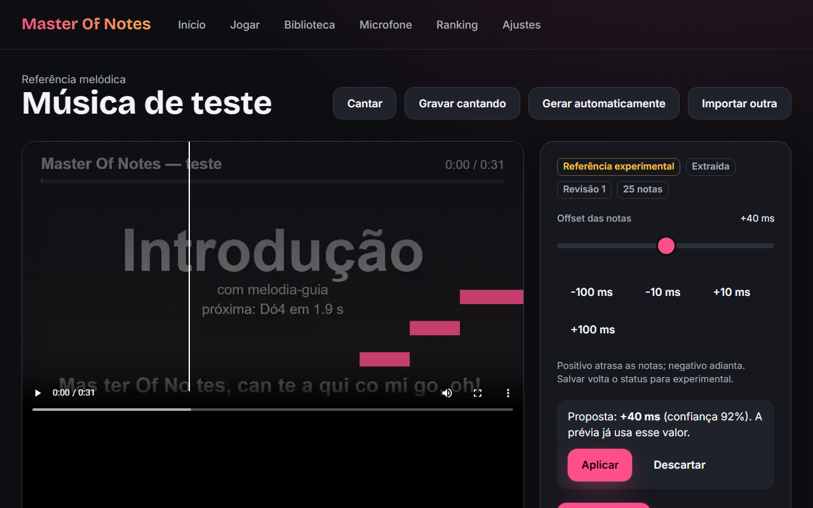

# 5. Referência melódica

[← Microfone](04-microfone.md) · [Índice](README.md) · [Próximo: Cantar →](06-cantar.md)

## O que é e por que é necessária

O vídeo de karaokê tem imagem, música e letra, mas **não diz ao computador quais notas devem ser cantadas**. A **referência melódica** é essa lista de notas: qual nota, quando começa e quanto dura. É contra ela que o Master Of Notes compara a sua voz.

- **Sem referência, não há pontuação.** Você pode cantar, mas o resultado mostra só métricas de treino (veja [Cantar](06-cantar.md#resultado)).
- A melodia vem de um arquivo, de alguém que a cante ou, se o vídeo tiver a voz do cantor, do próprio vídeo, com um modelo que você instala.

## De onde tirar a referência

Há três caminhos:

| Caminho | Quando usar | Selo da fonte |
|---|---|---|
| **Importar um arquivo** MIDI ou JSON | Quando você tem o arquivo da melodia. É o caminho **mais preciso**: as notas foram escritas uma a uma. | **MIDI** ou **JSON** |
| **[Gravar cantando](#gravar-cantando)** | Quando você **não tem** o arquivo. Alguém que conhece bem a música canta a melodia junto com o vídeo e o app anota as notas. | **Cantada** |
| **[Gerar automaticamente](#gerar-automaticamente-a-partir-do-vídeo)** | Quando o vídeo **tem a voz do cantor** e você instalou o modelo de separação. O app separa a voz da música e anota as notas sozinho. É o caminho mais rápido, mas **pode errar**: revise antes de validar. | **Extraída** |

Vídeo de karaokê **só instrumental** (sem a voz do cantor) não tem a melodia dentro dele. Para esses, use um arquivo ou Gravar cantando.

Os arquivos aceitos:

- **MIDI** (`.mid` ou `.midi`): o formato mais comum de arquivos de música "por notas". Um MIDI costuma ter várias trilhas (bateria, baixo, voz…); você escolhe qual é a da voz.
- **JSON no formato `mon-melody v1`**: o formato próprio do Master Of Notes, uma lista de notas em texto.

Use arquivos que você tenha o direito de usar. O app não vem com referências de músicas.

## Importar

1. Na [Biblioteca](03-biblioteca.md), clique em **Referência** na música (ou, na tela da música, em **Importar referência**).
2. Clique em **Importar referência**.
3. Escolha o arquivo `.mid`, `.midi` ou `.json`.

### Escolher a trilha da voz (MIDI)

Se o MIDI tiver mais de uma trilha com notas, o app pergunta **Qual trilha é a voz?** e mostra o nome e o número de notas de cada uma. Escolha a da melodia cantada; ela costuma se chamar "Voz", "Vocal", "Melody" ou o nome do cantor. Trilhas sem nome aparecem como *Trilha 1*, *Trilha 2*…

*Nomes de trilha de exemplo.*

Ao importar, a referência entra como **Referência experimental**: o app ainda não sabe se ela está alinhada com o seu vídeo.

## Gravar cantando

Sem o arquivo da melodia, dá para criar a referência **cantando**. A pessoa que grava canta a melodia junto com o vídeo, e o app anota cada nota: qual é, quando começa e quanto dura.

**A referência fica tão boa quanto quem cantou.** As notas gravadas viram o gabarito com que todo mundo vai ser comparado depois. Por isso:

- **Quem grava deve conhecer bem a melodia e cantar afinado.** Se errar uma nota na gravação, quem cantar certo depois perde ponto nessa nota.
- **Cante a melodia do cantor original**, sem enfeites nem improviso, e no tempo do vídeo.
- **Use fones de ouvido.** Sem fones, o microfone capta a música das caixas de som e o app pode anotar notas dos instrumentos.
- Prepare o [microfone](04-microfone.md) antes: dispositivo certo, calibração de ruído e latência.

**O app guarda só as notas, nunca a sua voz.** O som do microfone é analisado na hora e descartado, como no resto do app (veja [Privacidade](12-privacidade.md)).

### Passo a passo

1. Na tela da referência, clique em **Gravar cantando**.
2. Leia o painel **Gravar cantando** e clique em **Começar**.

   

3. Depois da contagem **3, 2, 1**, o vídeo toca do início. Enquanto o selo **Gravando notas** estiver aceso, cante a melodia. O medidor mostra que o microfone está ouvindo você.
4. Ao fim da música, a gravação para sozinha. Para terminar antes, clique em **Parar**.
5. O app mostra *"Salvando as notas…"* e volta para a tela da referência, com as notas desenhadas sobre o vídeo e os selos **Cantada** e **Referência experimental**.

*Notas e nível do microfone de exemplo.*

**Cancelar** descarta a gravação e não muda nada.

Se a música já tinha referência, o painel avisa: *"A referência atual fica no histórico; a nova nasce experimental."* A referência anterior não é apagada, mas deixa de ser a usada nas partidas.

Se o app detectar **menos de 3 notas** (microfone mudo, voz baixa demais, silêncio), nada é salvo: aparece o motivo e o botão **Gravar de novo**.

### Depois de gravar: revise e valide

Uma referência cantada entra como **experimental**, igual a um arquivo importado. Antes de valer ranking:

1. Dê play e confira as notas sobre o vídeo, como em [Alinhar com o vídeo](#alinhar-com-o-vídeo). Se as barras estiverem todas adiantadas ou atrasadas, ajuste o offset.
2. Se as notas estiverem erradas (nota fora da melodia, trecho faltando), grave de novo: quando a referência ativa é cantada, o botão se chama **Gravar de novo**.
3. Quando estiver tudo certo, clique em **Validar alinhamento**. Veja [Validar](#validar).

## Gerar automaticamente (a partir do vídeo)

Se o vídeo tem a **voz do cantor**, o app pode criar a referência sozinho: ele **separa a voz da música** do vídeo e **anota as notas** que essa voz canta. Para isso, você precisa instalar antes um **modelo de separação** (veja abaixo).

### Quando funciona

- **Só em vídeos com a voz do cantor.** Num vídeo de karaokê só instrumental, não há voz para separar. O app percebe isso, não salva nada e avisa: *"Este vídeo não tem a voz da melodia (é só instrumental). Use Gravar cantando ou importe um MIDI."*
- **A voz do vídeo vira o gabarito.** Se o cantor original enfeita, improvisa ou sai da melodia num trecho, a referência gerada copia isso.
- Coro, segunda voz, muito efeito na voz ou instrumentos com som parecido com o da voz podem gerar notas erradas. Por isso a revisão no fim é obrigatória.

### Instalar o modelo de separação

O app **não vem com o modelo** e **não baixa nada sozinho**. O modelo é um arquivo `.onnx` feito por outros autores. Quem baixa é você, da fonte original:

1. Em **[Ajustes](10-ajustes-e-modo-tv.md#referência-automática) → Referência automática**, veja a lista de modelos aceitos. Hoje há um: **UVR-MDX-NET Voc_FT** (cerca de 64 MB). A lista mostra o nome, o tamanho, a **Licença**, o nome do arquivo (`UVR-MDX-NET-Voc_FT.onnx`) e o SHA-256 (uma espécie de impressão digital do arquivo). **Leia o texto da licença** antes de continuar.
2. Clique em **Abrir página do modelo**. O endereço da fonte original abre no navegador. Para esse modelo, o endereço é o próprio arquivo, no repositório de modelos do projeto Ultimate Vocal Remover no GitHub, e o navegador começa a baixá-lo.
3. Espere o download terminar. Não renomeie nem abra o arquivo.
4. No app, marque **Li e aceito os termos da fonte; o modelo é de terceiros e o uso é de minha responsabilidade.** Só então o botão **Escolher arquivo baixado…** fica disponível.
5. Clique em **Escolher arquivo baixado…** e escolha o arquivo. O app mostra *"Conferindo o arquivo…"* e verifica se ele é **exatamente** um dos modelos da lista. Se for, guarda uma cópia na pasta de dados do app, e a seção passa a mostrar *"<nome do modelo> · instalado em <data>"*. Um arquivo diferente (outro modelo, outra versão ou um download que veio corrompido) é **recusado**, com a explicação.

Para desinstalar o modelo, clique em **Remover** na mesma seção.

> **Modelo de terceiros: leia antes de baixar.** O modelo não é do Master Of Notes, e o app não o distribui. Ele é do projeto **Ultimate Vocal Remover (UVR)**. **Os autores não declararam uma licença para o modelo**: o código do UVR é aberto (licença MIT) e os autores pedem crédito, mas não há uma permissão clara para usar o arquivo do modelo, e não se sabe se o uso comercial é permitido. A decisão de baixar e usar o modelo é sua, sob os termos da fonte e sob a sua responsabilidade.

O modelo fica no seu computador. O app nunca envia o modelo nem o áudio para lugar nenhum.

### Passo a passo

1. Na tela da referência, clique em **Gerar automaticamente**. Sem o modelo instalado, o app avisa e abre **Ajustes → Referência automática**.
2. No painel **Gerar automaticamente**, clique em **Começar**.
3. O app trabalha em 4 etapas, com uma barra de progresso: **Etapa 1 de 4: Extraindo áudio**, **Etapa 2 de 4: Separando a voz** (com a porcentagem), **Etapa 3 de 4: Transcrevendo** e **Etapa 4 de 4: Salvando**.
4. Isso leva **cerca de 2,5 minutos para uma música de 4 minutos** num processador de notebook recente, e mais em computadores mais lentos ou ocupados com outros programas. Durante a separação, o app usa bastante memória (até cerca de 1,4 GB). **Fique nesta tela**: o próprio painel avisa *"Fique nesta tela até terminar: se sair, a geração será cancelada."*
5. **Cancelar** interrompe o trabalho e não salva nada (*"Geração cancelada."*). Fechar o app também cancela.
6. No fim, a tela mostra as notas sobre o vídeo, com os selos **Extraída** e **Referência experimental**, e o aviso *"Referência gerada em m:ss. Pode ter erros: confira sobre o vídeo e valide."*

*Animação encurtada, com notas de exemplo: a geração real leva alguns minutos, e o aviso final mostra o tempo de verdade.*

Se a música já tinha referência, o painel avisa: *"A referência atual vai para o histórico; a nova nasce experimental."* A anterior fica guardada e deixa de ser usada nas partidas, como em Gravar cantando.

Num vídeo só instrumental, o painel mostra a mensagem de que o vídeo não tem a voz da melodia, e nada é salvo:

### Revise antes de validar

**A referência gerada pode ter erros**: notas que faltam, notas a mais (de um coro ou de um instrumento que passou junto com a voz) ou notas na altura errada. Ela **nunca é validada sozinha**.

1. Dê play e acompanhe as notas sobre o vídeo do começo ao fim, como em [Alinhar com o vídeo](#alinhar-com-o-vídeo).
2. Se as notas acompanham a voz, clique em **Validar alinhamento**.
3. Se houver erros, prefira outro caminho. O app não tem editor de notas: dá para ajustar o offset, mas não corrigir uma nota de cada vez. Use **Gravar cantando** ou importe um MIDI.

O áudio do vídeo é analisado na memória e descartado. Só as notas são guardadas.

## Alinhar com o vídeo

O MIDI e o vídeo raramente começam no mesmo instante. Às vezes o vídeo tem uma introdução mais longa, por exemplo. Por isso, confira o alinhamento:

1. Na tela da referência, dê play no vídeo. As **notas da referência aparecem desenhadas por cima do vídeo**: cada barra é uma nota (mais alta na tela = nota mais aguda), e a linha branca vertical marca o instante atual. A nota que está tocando agora fica **amarela**.
2. Compare com a voz do vídeo (ou com a letra destacada). Se as barras chegam **antes** da voz, aumente o offset. Se chegam **depois**, diminua.
3. Ajuste com o controle **Offset das notas** (até ±10 segundos) ou com os botões **−100 ms**, **−10 ms**, **+10 ms** e **+100 ms**. *Positivo atrasa as notas; negativo adianta.*
4. Clique em **Salvar offset**. Para voltar ao valor salvo, use **Desfazer**.

Salvar um novo offset volta a referência para **experimental**, porque o alinhamento mudou e precisa ser conferido de novo.

### Alinhar automaticamente

Em vez de procurar o offset à mão, clique em **Alinhar automaticamente**, no cartão do offset. O app extrai o áudio do vídeo (*"Extraindo áudio do vídeo…"*), compara as notas da referência com a música (*"Calculando o alinhamento…"*) e **propõe** um offset, por exemplo: *"Proposta: +1200 ms (confiança 92%). A prévia já usa esse valor."* Funciona com qualquer referência (MIDI, JSON, Cantada ou Extraída) e não precisa do modelo de separação.

O app só propõe: **nada é salvo sozinho**. Dê play e confira a prévia sobre o vídeo:

- se estiver certa, clique em **Aplicar** para salvar o offset;
- se não estiver, clique em **Descartar** para voltar ao offset anterior, e ajuste à mão.

*Proposta e confiança de exemplo.*

Com *"Confiança baixa: confira pelo vídeo antes de aplicar."*, confira com mais cuidado. Se o offset atual já estiver certo, o app só avisa: *"O alinhamento atual já confere (confiança Y%)."*

## Validar

Quando as notas acompanharem a voz do vídeo, clique em **Validar alinhamento**. A referência passa a **Referência validada** e as partidas dessa música **valem ranking** (desde que o [teste de vazamento](04-microfone.md#teste-de-vazamento) esteja aprovado).

Se você salvou o offset e ainda não validou, aparece *"Salve o offset antes de validar."*

Se a referência estiver errada (trilha errada, música diferente), clique em **Marcar inválida**. Partidas com referência inválida viram treino até você importar outra com **Importar outra**, [gravar cantando](#gravar-cantando) ou [gerar automaticamente](#gerar-automaticamente-a-partir-do-vídeo).

## Experimental x validada

| | Experimental | Validada |
|---|---|---|
| Dá para cantar? | Sim | Sim |
| Mostra pontuação? | Sim | Sim |
| Vale ranking? | **Não** (treino) | **Sim** |
| Aparece em Festa, Duelo e Desafio? | Não | Sim |

Importar outra referência (ou gravar cantando, ou gerar automaticamente) cria uma referência nova, e salvar um novo offset aumenta a **revisão** (o selo *Revisão N*). A referência anterior fica guardada no histórico. Notas feitas com uma referência ou revisão antiga ficam no histórico como **Versão anterior** e não se misturam com o ranking atual. Veja [Ranking e histórico](09-ranking-e-historico.md#versão-anterior).

---

[← Microfone](04-microfone.md) · [Índice](README.md) · [Próximo: Cantar →](06-cantar.md)
