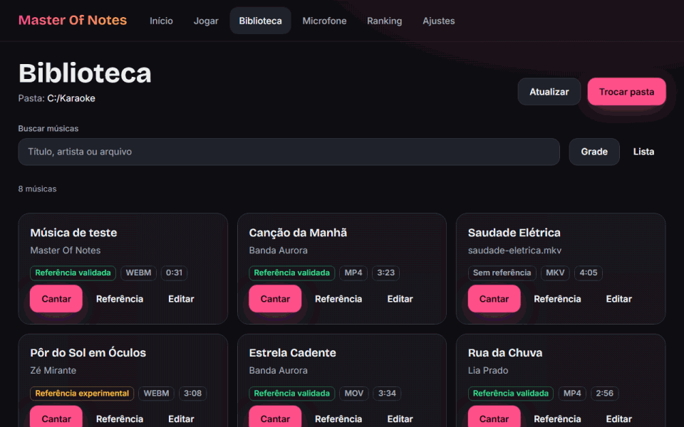
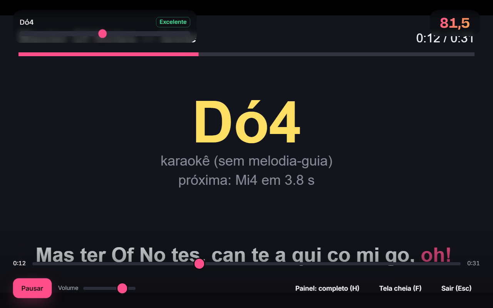
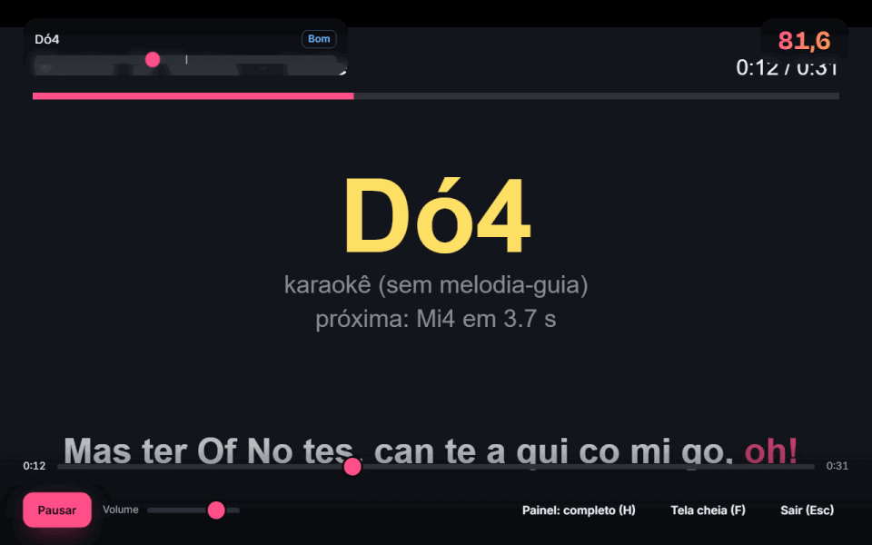
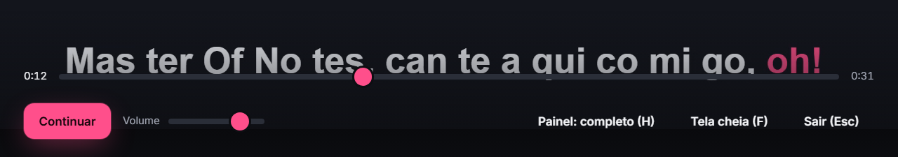
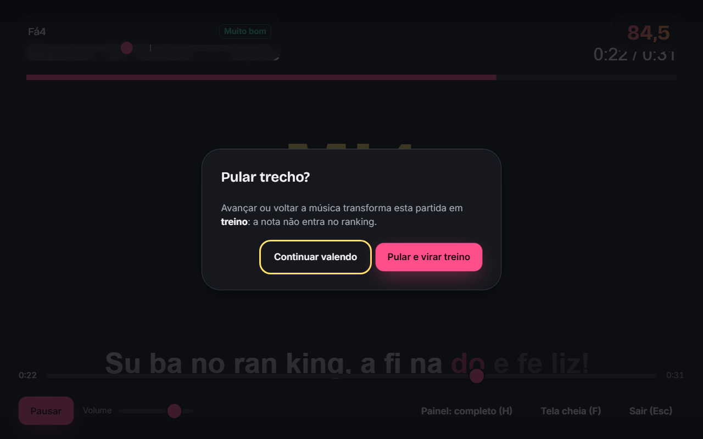
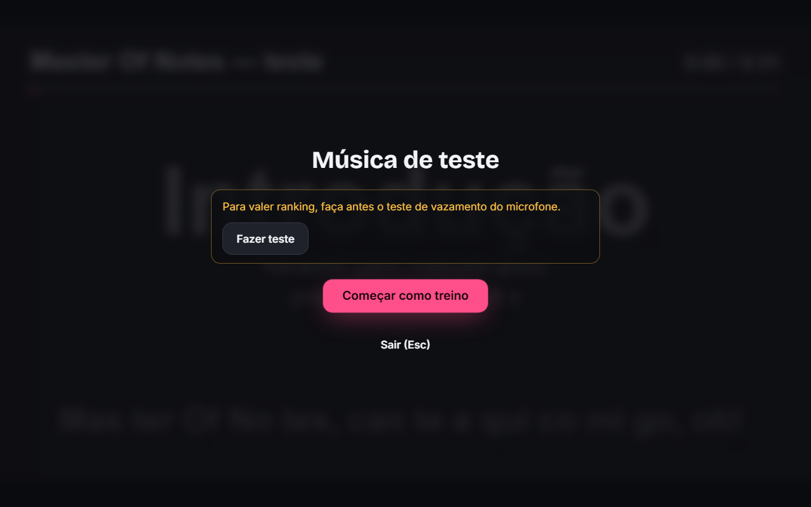
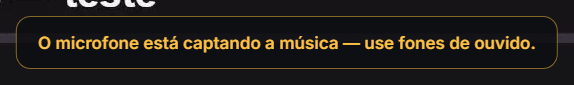
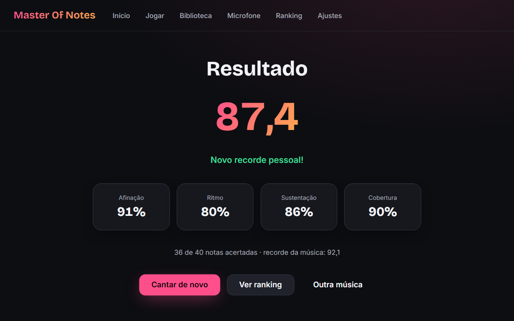
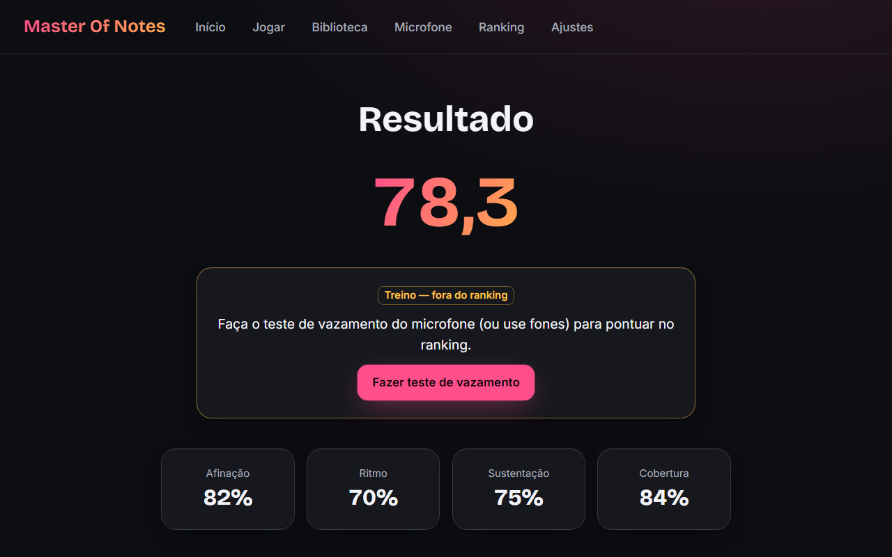

# 6. Cantar

[← Referência melódica](05-referencia-melodica.md) · [Índice](README.md) · [Próximo: Como a pontuação funciona →](07-pontuacao.md)

## Abrir o player

Há três caminhos:

- **Biblioteca → Cantar**, no cartão da música;
- **Cantar**, no topo da tela da música;
- **Cantar**, na rodada atual de uma partida (veja [Modos de jogo](08-modos-de-jogo.md)).

Cantando pela Biblioteca, a apresentação fica **sem nome de cantor** e aparece como *Anônimo* no ranking. Para registrar seu nome, use o modo **Solo** em **Jogar** (veja [Modos de jogo](08-modos-de-jogo.md#solo)).

O player ocupa a janela toda (o menu some). Aparece o nome da música e o botão **Começar**. Clique nele: vem a contagem **3, 2, 1** e o vídeo começa.

*Animação com música de teste própria do projeto e notas ilustrativas.* Vídeo opcional do fluxo completo, do Começar ao Resultado: [cantar-fluxo-completo.webm](media/cantar-fluxo-completo.webm) (o GitHub não toca o vídeo na página; baixe ou abra o arquivo).

## Durante a música

*Notas e pontuação ilustrativas.*

### O painel de feedback

No alto da tela:

- **À esquerda, a nota que você deve cantar** (por exemplo, *Ré4*; veja [nome das notas](14-glossario.md#nome-das-notas)) e uma avaliação dos últimos instantes: **Excelente**, **Muito bom**, **Bom**, **Precisa melhorar** ou **Não detectado** (o app não ouviu voz).
- **A bolinha** mostra sua afinação: no centro = afinado; à direita = você está **acima** da nota (mais agudo); à esquerda = **abaixo** (mais grave).
- **À direita, a pontuação parcial**, que considera só as notas que já terminaram. Se a partida for treino, aparece o selo **Treino**.
- Nos trechos sem canto (introdução, solos), aparece *"Aguardando a próxima nota…"*. Esses trechos não contam para a nota.

A parte de baixo da tela fica livre para a letra do vídeo.

O painel tem três modos. Troque com a tecla **H** ou o botão **Painel**:

| Modo | Mostra |
|---|---|
| **Completo** | Nota, afinação e pontuação |
| **Compacto** | Só a pontuação |
| **Oculto** | Nada |

O modo escolhido fica salvo. Ele também pode ser escolhido em [Ajustes](10-ajustes-e-modo-tv.md).

### Controles

Mexa o mouse ou aperte uma tecla para mostrar os controles. Eles somem sozinhos depois de 3 segundos.

| Controle | Tecla | O que faz |
|---|---|---|
| **Pausar** / **Continuar** | Espaço | Pausa e retoma. Pausar não tira a partida do ranking. |
| Barra de posição | ← / → | Volta ou avança 5 segundos. Numa partida que vale ranking, pede confirmação (veja abaixo). |
| **Volume** | ↑ / ↓ | Sobe ou desce 5%. Fica salvo. |
| **Painel** | H | Troca o modo do painel. |
| **Tela cheia** | F | Liga e desliga a tela cheia. |
| **Sair** | Esc | Sai do player. **A partida é descartada: nada é salvo.** |

### Pular trecho = treino

Avançar ou voltar a música numa partida que vale ranking abre a pergunta **Pular trecho?**:

- **Continuar valendo**: não pula, e a partida continua valendo.
- **Pular e virar treino**: pula, e a partida passa a ser treino. Aparece o selo **Treino — fora do ranking**.

## Valendo ranking ou treino?

Uma partida **vale ranking** quando:

1. a música tem **referência validada** ([Referência melódica](05-referencia-melodica.md#validar));
2. o **teste de vazamento** está aprovado para o microfone e o volume atuais ([Microfone](04-microfone.md#teste-de-vazamento));
3. você **não pula trechos** durante a música;
4. o **áudio do microfone chega sem falhas**: se mais de 5% do áudio se perder (por exemplo, um microfone USB com mau contato), a partida vira treino;
5. **pelo menos metade da música** é tocada.

Senão, ela é **treino**: você recebe a nota, ela fica no histórico com o selo **Treino**, mas não entra no ranking. O motivo aparece na tela [Resultado](#resultado). Os motivos que já se sabem antes de começar também aparecem no player, com a música pausada:

| Motivo mostrado | Como resolver |
|---|---|
| *Faça o teste de vazamento do microfone (ou use fones) para pontuar no ranking.* | Faça o [teste de vazamento](04-microfone.md#teste-de-vazamento). |
| *A referência desta música ainda não foi validada: a apresentação é só treino.* | [Valide o alinhamento](05-referencia-melodica.md#validar). |
| *A referência desta música foi marcada como inválida: a apresentação é só treino.* | [Importe outra referência](05-referencia-melodica.md#importar). |
| *Esta música não tem referência melódica: não há pontuação, só métricas de treino.* | [Importe uma referência](05-referencia-melodica.md#importar). |

Se a música tem referência validada mas o teste de vazamento não foi feito (ou precisa ser refeito), o player avisa antes de começar e troca o botão para **Começar como treino**. O botão **Fazer teste** leva à tela do Microfone.

### Aviso: o microfone está captando a música

Se o app ouvir som no microfone nos trechos em que ninguém deveria estar cantando, aparece:

Use fones de ouvido ou baixe o volume.

## Resultado

Quando o vídeo termina, aparece a tela **Resultado**.

*Valores ilustrativos.*

- **A nota**, de 0 a 100.
- **Novo recorde pessoal!** quando você iguala ou supera a sua melhor nota nessa música.
- **Afinação**, **Ritmo**, **Sustentação** e **Cobertura**, em porcentagem. O que cada uma significa está em [Como a pontuação funciona](07-pontuacao.md).
- Quantas notas você acertou e o recorde da música.
- Botões: **Cantar de novo**, **Ver ranking** e **Outra música**. Numa partida com rodadas, o botão principal é **Voltar para a partida**.

### Quando a partida valeu como treino

Logo abaixo da nota aparece um cartão amarelo com o selo **Treino — fora do ranking** e o motivo. Quando há uma correção direta, o cartão traz um botão que leva até ela.

*Valores ilustrativos.*

| Motivo mostrado | Botão | O que fazer |
|---|---|---|
| *Faça o teste de vazamento do microfone (ou use fones) para pontuar no ranking.* | **Fazer teste de vazamento** | Faça o [teste](04-microfone.md#teste-de-vazamento) e cante de novo. |
| *A referência desta música ainda não foi validada: a apresentação é só treino.* | **Abrir referência** | [Confira e valide o alinhamento](05-referencia-melodica.md#validar). |
| *A referência desta música foi marcada como inválida: a apresentação é só treino.* | **Abrir referência** | [Importe outra referência](05-referencia-melodica.md#importar). |
| *Esta música não tem referência melódica: não há pontuação, só métricas de treino.* | **Importar referência** | [Importe uma referência](05-referencia-melodica.md#importar). |
| *A música foi avançada ou voltada durante a performance. Esta performance conta como treino.* | — | Cante de novo sem pular trechos. |
| *O áudio do microfone teve falhas (N% do áudio não chegou). Esta performance conta como treino.* | — | Confira o cabo ou a conexão USB do microfone, feche programas pesados e cante de novo. |
| *Menos da metade da música foi tocada: a apresentação valeu como treino.* | — | Cante a música até o fim. |

### Música sem referência

Sem referência não há nota. O cartão de treino aparece com o botão **Importar referência**, e embaixo vêm só as **Métricas exploratórias (fora do ranking)**:

- **Tempo cantando**: em quanto da música o app ouviu voz;
- **Estabilidade da afinação**: o quanto sua voz ficou firme, sem oscilar, em cada nota que você sustentou.

*Valores ilustrativos.*

---

[← Referência melódica](05-referencia-melodica.md) · [Índice](README.md) · [Próximo: Como a pontuação funciona →](07-pontuacao.md)
