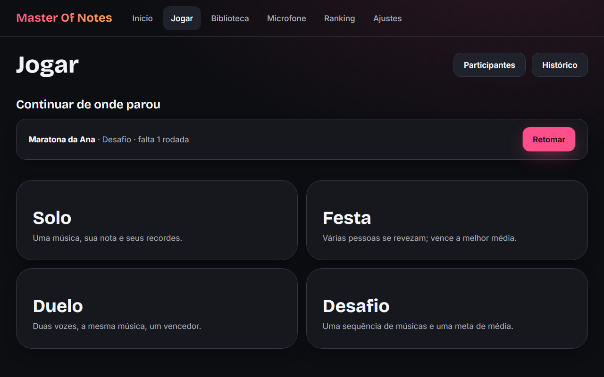
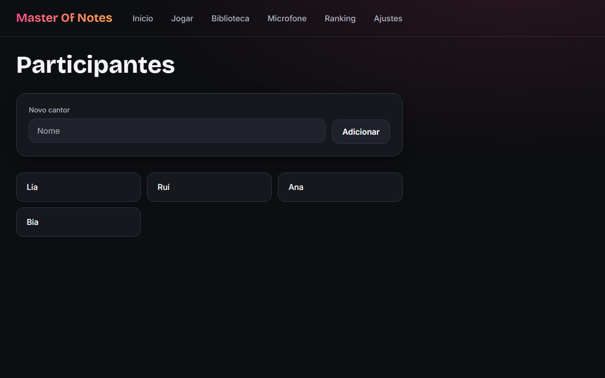
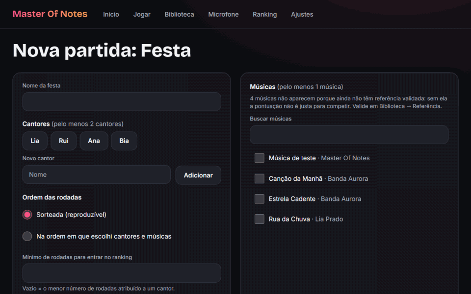
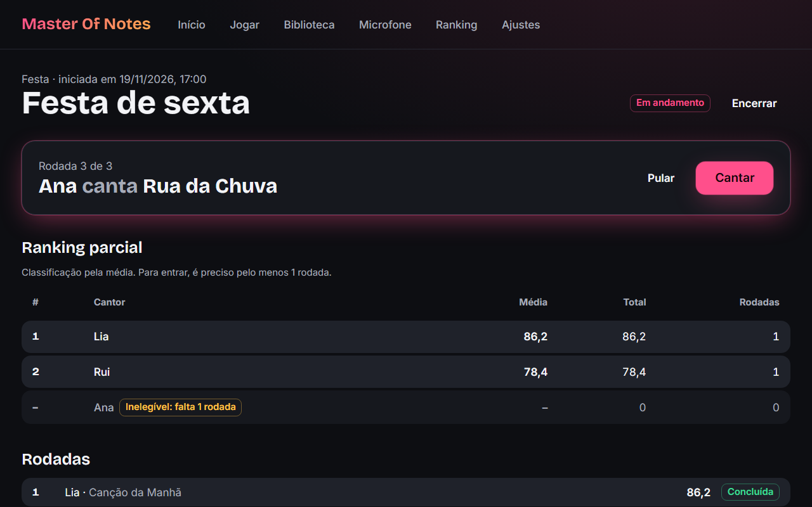
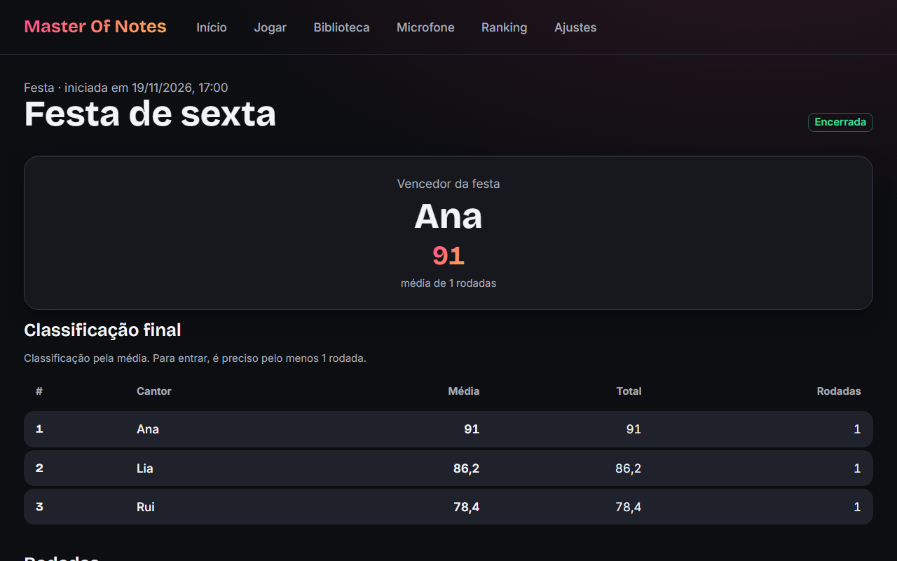
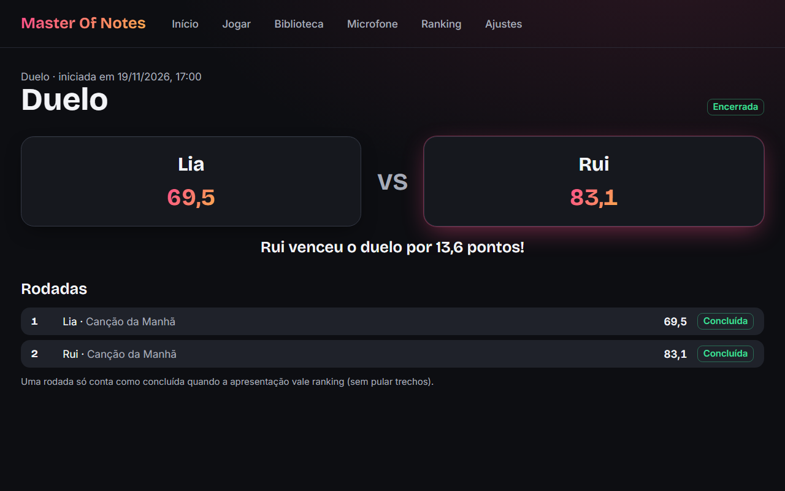
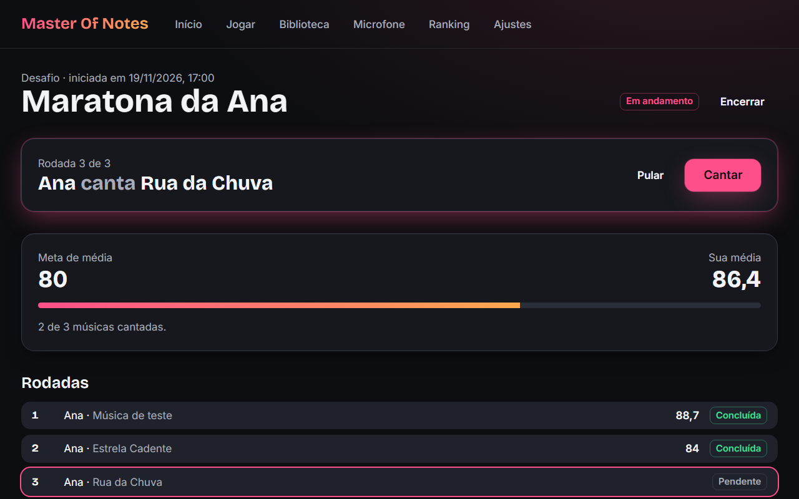

# 8. Modos de jogo

[← Como a pontuação funciona](07-pontuacao.md) · [Índice](README.md) · [Próximo: Ranking e histórico →](09-ranking-e-historico.md)

Clique em **Jogar** no menu. Há quatro modos:

*Nomes de exemplo.*

| Modo | Em uma frase | Cantores | Músicas | Só músicas validadas? |
|---|---|---|---|---|
| **Solo** | Uma música, sua nota e seus recordes. | nenhum ou 1 | exatamente 1 | não |
| **Festa** | Várias pessoas se revezam; vence a melhor média. | pelo menos 2 | pelo menos 1 | **sim** |
| **Duelo** | Duas vozes, a mesma música, um vencedor. | exatamente 2 | exatamente 1 | **sim** |
| **Desafio** | Uma sequência de músicas e uma meta de média. | nenhum ou 1 | pelo menos 1 | **sim** |

Festa, Duelo e Desafio só mostram músicas com **referência validada**, porque sem ela a pontuação não é justa para competir. A tela avisa quantas músicas ficaram de fora. Para incluir uma, valide a referência dela (veja [Referência melódica](05-referencia-melodica.md#validar)).

## Participantes

Os cantores ficam cadastrados para aparecer com nome no ranking. Em **Jogar → Participantes**, digite o nome em **Novo cantor** e clique em **Adicionar** (ou aperte Enter). Também dá para cadastrar alguém na hora de criar a partida.

- O nome tem até 40 caracteres.
- Não pode repetir um nome já cadastrado (maiúsculas e minúsculas contam como iguais: "ana" e "Ana" são o mesmo nome).

*Nomes de exemplo.*

## Como criar uma partida

1. Em **Jogar**, clique no modo.
2. Preencha a tela **Nova partida**: cantores, músicas e as opções do modo.
3. Enquanto faltar algo, a lista em amarelo diz o quê (por exemplo, *"Escolha pelo menos 2 cantores."*).
4. Clique em **Criar** (o botão diz o modo: **Criar festa**, **Criar duelo**…).

### Quantas rodadas?

Cada rodada é **um cantor cantando uma música**. O número de rodadas é **o maior entre o número de cantores e o de músicas**, e todos cantam pelo menos uma vez e todas as músicas são usadas pelo menos uma vez. Exemplos:

- 3 cantores e 3 músicas → 3 rodadas (cada um canta uma).
- 4 cantores e 2 músicas → 4 rodadas (as músicas se repetem).
- Desafio com 5 músicas → 5 rodadas.

## A tela da partida

*Nomes e notas ilustrativos.*

- No alto, o cartão da **rodada atual**: quem canta qual música. **Cantar** abre o player; **Pular** deixa a rodada para depois.
- **Rodadas** lista todas, com o estado de cada uma: **Pendente**, **Concluída** ou **Pulada**. Uma rodada pulada pode voltar com **Voltar para a fila**.
- **Uma rodada só fica concluída quando a apresentação vale ranking.** Se virar treino (por exemplo, porque alguém pulou um trecho da música), a rodada continua pendente e pode ser cantada de novo. Veja [Valendo ranking ou treino?](06-cantar.md#valendo-ranking-ou-treino).
- Depois do Resultado, **Voltar para a partida** traz você de volta para esta tela.
- **Encerrar** termina a partida. Se ainda houver rodadas pendentes, o app pergunta **Encerrar a partida?**: **Continuar jogando** ou **Encerrar agora**. O resultado fica com o que foi cantado até ali.

### Fechou o app no meio?

A partida fica salva. Em **Jogar**, ela aparece em **Continuar de onde parou** com quantas rodadas faltam. Clique em **Retomar**.

## Solo

Para cantar uma música com o seu nome no ranking. Escolha você (ou ninguém, para cantar sem nome) e a música. Diferente dos outros modos, aceita músicas sem referência validada, mas aí a apresentação é treino (veja [Cantar](06-cantar.md#valendo-ranking-ou-treino)).

Cantar direto pela **Biblioteca** também funciona, mas sem nome: no ranking aparece *Anônimo*.

## Festa

- **Nome da festa** é obrigatório.
- **Ordem das rodadas**: **Sorteada (reproduzível)**, em que o app embaralha cantores e músicas, ou **Na ordem em que escolhi cantores e músicas**. Na ordem manual, os botões mostram a posição (1., 2., …).
- **Mínimo de rodadas para entrar no ranking**: quem cantar menos rodadas que isso fica **Inelegível**. Vazio = o menor número de rodadas que algum cantor recebeu.
- A classificação é pela **média** das rodadas concluídas de cada cantor. Durante a festa aparece o **Ranking parcial**; ao encerrar, a **Classificação final** e o **Vencedor da festa**.

*Nomes e notas ilustrativos.*

## Duelo

Dois cantores, a mesma música, uma rodada para cada um. Quem tiver a nota maior vence; notas iguais dão empate.

*Nomes e notas ilustrativos.*

Enquanto só um cantou, a tela diz *"O duelo termina quando os dois cantarem."*

## Desafio

Uma sequência de músicas para bater uma meta.

- **Nome do desafio (opcional)**.
- **Meta de pontuação média (0–100)**. O padrão é 80.
- A tela mostra a **Meta de média**, a **Sua média** (das rodadas concluídas) e o progresso. No fim aparece **Desafio cumprido!** ou **Desafio não cumprido desta vez.**

*Nomes e notas ilustrativos.*

---

[← Como a pontuação funciona](07-pontuacao.md) · [Índice](README.md) · [Próximo: Ranking e histórico →](09-ranking-e-historico.md)
