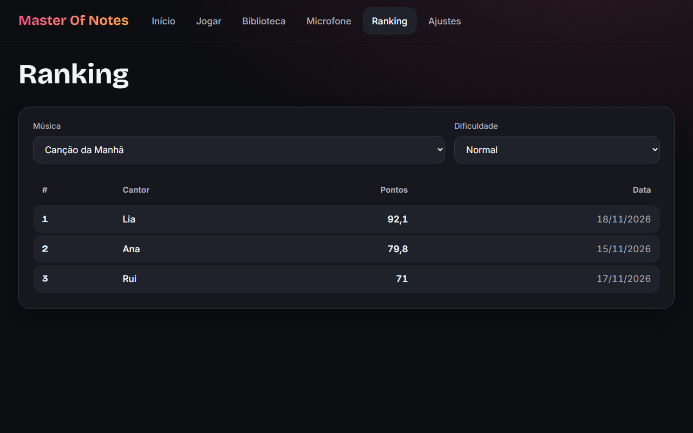
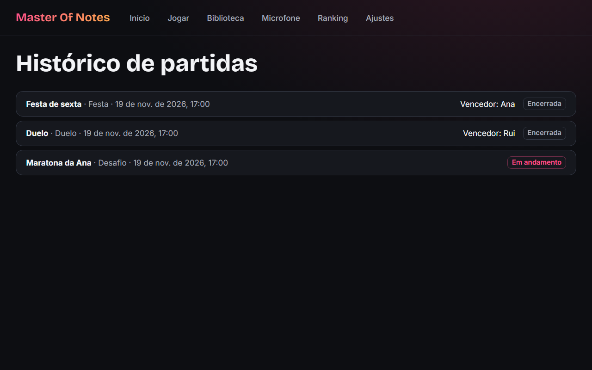

# 9. Ranking e histórico

[← Modos de jogo](08-modos-de-jogo.md) · [Índice](README.md) · [Próximo: Ajustes e Modo TV →](10-ajustes-e-modo-tv.md)

## Ranking

Clique em **Ranking** no menu e escolha a **Música** e a **Dificuldade**.

*Nomes e notas ilustrativos.*

O ranking de cada música:

- é **separado por dificuldade**: notas do Fácil não competem com as do Difícil;
- só tem apresentações que **valeram ranking** (veja [Valendo ranking ou treino?](06-cantar.md#valendo-ranking-ou-treino));
- só compara notas feitas **com a mesma referência e a mesma versão do cálculo** (veja [Versão anterior](#versão-anterior));
- mostra *Anônimo* para quem cantou sem escolher um cantor (pela Biblioteca, ou no Solo sem nome).

Se ninguém pontuou ainda, aparece *"Ninguém pontuou nesta música ainda. Seja o primeiro!"*

O Resultado de cada apresentação tem o botão **Ver ranking**, e a tela da música tem **Ranking completo**.

## Recordes na tela da música

Na tela de cada música (clique no título dela na Biblioteca), o quadro **Recordes** mostra:

- o **recorde da música** e quem fez;
- as **5 melhores notas** na dificuldade atual;
- **Recorde pessoal de**: escolha um cantor para ver a melhor nota dele que vale ranking nessa música e nessa dificuldade.

Veja a imagem em [Biblioteca → Tela da música](03-biblioteca.md#tela-da-música-detalhes).

## Suas apresentações

Também na tela da música, **Suas apresentações** lista as últimas 10 vezes que alguém cantou aquela música, com nota, cantor, dificuldade e data. Dois selos podem aparecer:

- **Treino**: a apresentação não valeu ranking.
- **Versão anterior**: veja abaixo.

### Versão anterior

Cada nota fica guardada junto com **as condições em que foi feita**: qual referência melódica, qual revisão dela (os ajustes de alinhamento) e qual versão do cálculo de pontuação. Se uma dessas coisas muda, comparar a nota antiga com uma nova não seria justo: a régua mudou.

Por isso:

- notas feitas com uma referência, uma revisão ou uma versão do cálculo **diferente da atual** ganham o selo **Versão anterior**;
- elas **continuam no histórico** (nada é apagado);
- elas **não entram no ranking atual** da música.

Isso acontece quando você importa outra referência, salva um novo offset ([Referência melódica](05-referencia-melodica.md)) ou quando uma atualização do app muda o cálculo ([Como a pontuação funciona](07-pontuacao.md#até-onde-dá-para-confiar)).

## Histórico de partidas

Em **Jogar → Histórico** ficam todas as partidas (Festa, Duelo, Desafio e Solo), da mais recente para a mais antiga, com o modo, a data, o vencedor (quando houver) e a situação:

| Situação | Significa |
|---|---|
| **Em andamento** | Ainda tem rodadas para cantar. Clique para continuar. |
| **Encerrada** | Terminou. |

*Nomes de exemplo.*

Clique numa partida para abrir a tela dela, com as rodadas e a classificação.

---

[← Modos de jogo](08-modos-de-jogo.md) · [Índice](README.md) · [Próximo: Ajustes e Modo TV →](10-ajustes-e-modo-tv.md)
