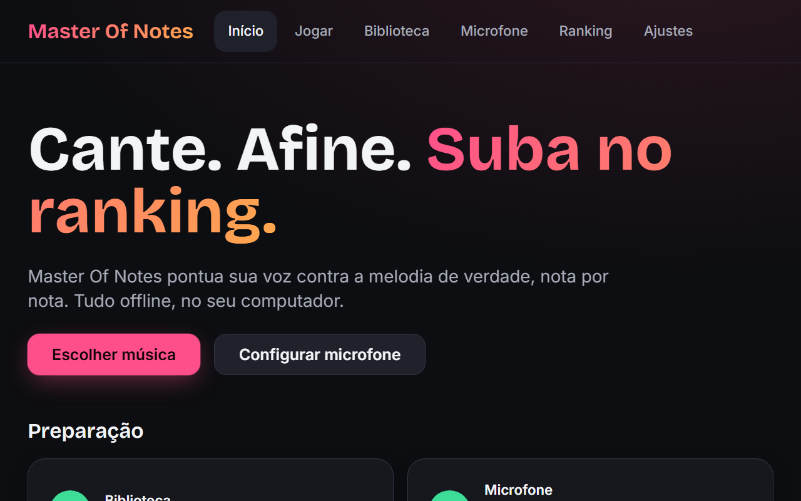
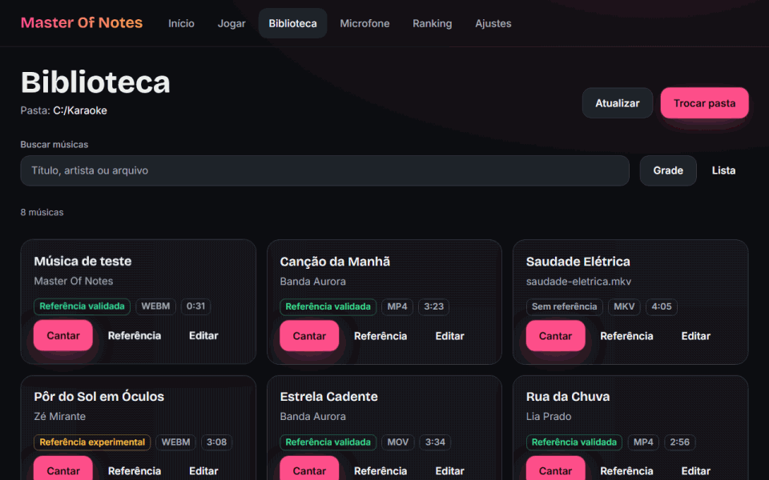

# 10. Ajustes, Modo TV e controle por setas

[← Ranking e histórico](09-ranking-e-historico.md) · [Índice](README.md) · [Próximo: Atualizações →](11-atualizacoes.md)

Clique em **Ajustes** no menu. Cada mudança é salva na hora; não há botão de salvar.

## Jogo

- **Dificuldade**: **Fácil**, **Normal** (padrão) ou **Difícil**. Define *quanto a afinação pode desviar para contar como acerto*. **O ranking separa por dificuldade.** Detalhes em [Como a pontuação funciona](07-pontuacao.md#afinação-e-os-cents).
- **Painel de feedback no player**: **Completo (nota e afinação)**, **Compacto (só pontuação)** ou **Oculto**. Também muda com a tecla **H** durante a música.

## Tela e acessibilidade

- **Modo TV**: *textos e botões maiores, para ver de longe.* Use quando o computador estiver ligado na TV da sala.
- **Reduzir movimento**: diminui animações e transições.
  - **Seguir o sistema** (padrão): segue a opção de animações do Windows (*Configurações → Acessibilidade → Efeitos visuais → Efeitos de animação*).
  - **Sempre reduzir** ou **Nunca reduzir**: ignora o Windows.

## Biblioteca

- **Procurar também nas subpastas**: se ligado (padrão), as pastas dentro da pasta da biblioteca também entram na busca. Vale a partir da próxima atualização da biblioteca (botão **Atualizar** na [Biblioteca](03-biblioteca.md)).

## Atualizações

- **Verificar atualizações ao abrir**: *é o único uso de internet do app. Nada é instalado sem você confirmar.* Desligado por padrão.
- **Verificar agora**: procura uma versão nova neste momento. Veja [Atualizações](11-atualizacoes.md).

## Referência automática

Aqui você instala o **modelo de separação** usado por **Gerar automaticamente**. A lista mostra os modelos aceitos, com nome, tamanho, licença, arquivo e SHA-256, e o botão **Abrir página do modelo**. O app não baixa o modelo: você baixa pelo navegador, marca **Li e aceito os termos da fonte…** e clica em **Escolher arquivo baixado…**. Com o modelo instalado, aparecem a data da instalação e o botão **Remover**. Veja [Instalar o modelo de separação](05-referencia-melodica.md#instalar-o-modelo-de-separação), com o aviso sobre a licença.

## Microfone e volume

O microfone, a calibração, a latência e o volume da música ficam na tela [Microfone](04-microfone.md), não em Ajustes.

## Usar só o teclado ou um controle remoto

Todo o app funciona sem mouse. Isso inclui controles remotos e teclados sem fio que enviam **setas**, **Enter** e **Esc**, comuns em TVs.

| Tecla | Fora do player | No player |
|---|---|---|
| **Setas** | Movem o foco para o botão ou cartão mais próximo naquela direção | ← → voltam ou avançam 5 s; ↑ ↓ mudam o volume |
| **Enter** | Aciona o botão em foco | Aciona o botão em foco |
| **Esc** | Volta para a tela anterior (ou fecha a janela aberta) | Sai do player (a partida é descartada) |
| **Tab** / **Shift+Tab** | Próximo / anterior, na ordem da tela | Idem |
| **Espaço** | Aciona o botão em foco | Pausa e continua |
| **H**, **F** | — | Painel de feedback, tela cheia |

O elemento em foco ganha um contorno bem visível.

---

[← Ranking e histórico](09-ranking-e-historico.md) · [Índice](README.md) · [Próximo: Atualizações →](11-atualizacoes.md)
