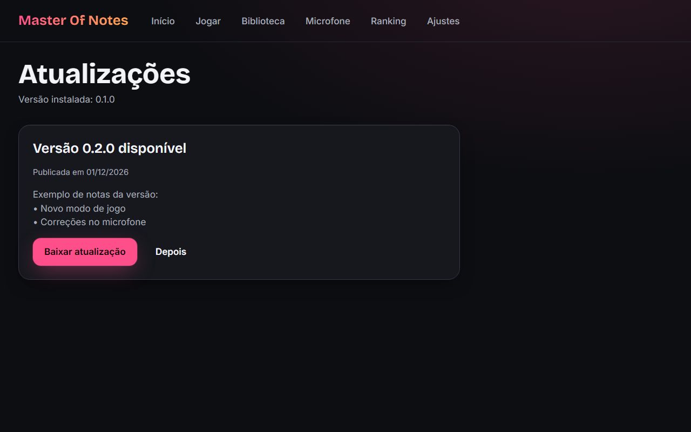
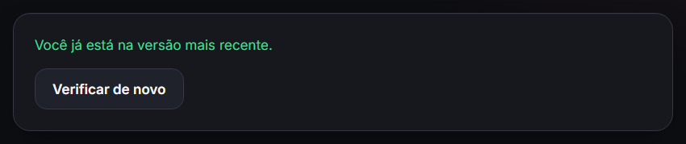
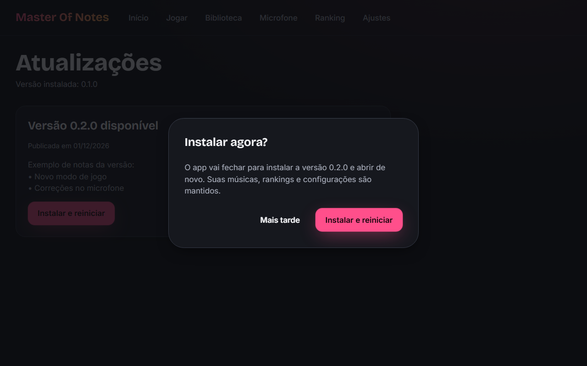
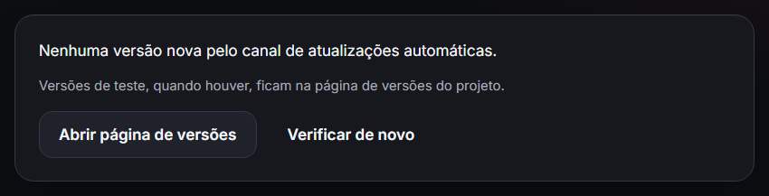

# 11. Atualizações

[← Ajustes e Modo TV](10-ajustes-e-modo-tv.md) · [Índice](README.md) · [Próximo: Privacidade →](12-privacidade.md)

O Master Of Notes pode se atualizar sozinho, mas **só procura versões novas se você permitir** e **nunca instala nada sem você confirmar**.

## Procurar uma versão nova

Há dois jeitos:

- **Automático ao abrir**: ligue **Verificar atualizações ao abrir** em [Ajustes](10-ajustes-e-modo-tv.md) (ou responda **Sim, verificar** na pergunta da primeira execução). Se houver versão nova, o app só avisa: *"Versão X disponível. Veja em Ajustes → Verificar agora."*
- **Na hora**: em **Ajustes**, clique em **Verificar agora**.

A tela **Atualizações** mostra a **versão instalada** e o resultado:

*Versão e notas de exemplo.*

- **Baixar atualização** baixa a versão nova e mostra o progresso em MB.
- **Depois** deixa para outra hora.

Se já estiver em dia: *"Você já está na versão mais recente."*

## Instalar

Quando o download termina, o app pergunta **Instalar agora?**:

- **Instalar e reiniciar**: o app fecha, o instalador roda e o app abre de novo já na versão nova.
- **Mais tarde**: não instala agora. Para instalar depois, use **Instalar e reiniciar** na mesma tela.

A atualização **nunca acontece no meio de uma música**: a tela de atualizações só é aberta fora do player.

## Seus dados

**Suas músicas, rankings, cantores e ajustes são mantidos.** Eles ficam numa pasta separada do programa (veja [Instalação](01-instalacao.md#onde-as-coisas-ficam)). Se uma versão nova precisar mudar o formato dos dados, o app faz uma cópia de segurança do banco antes.

### Versões que atualizam os seus dados

Algumas versões mudam o formato do banco de dados. A **0.1.4** é uma delas. Antes de mudar, o app guarda uma cópia do banco antigo, `masterofnotes.db.bak-v1`, na mesma pasta dos seus dados (`%APPDATA%\com.masterofnotes.karaoke\`).

Depois dessa atualização, **uma versão anterior do app não abre mais o banco**: ela avisa: *"…foi criado por uma versão mais nova do Master Of Notes. Atualize o aplicativo."* (nas versões até a 0.1.3, o nome aparece escrito junto: "MasterOfNotes"). Voltar para uma versão anterior **não é suportado**. A cópia `.bak-v1` existe só para emergências: ela tem os dados de antes da atualização, sem nada do que você fez depois.

## Segurança

Cada atualização é **assinada digitalmente** pelo projeto. Se a assinatura não bater, o app recusa a atualização e não instala nada.

## Se der erro

*"Não foi possível verificar ou baixar a atualização. O app continua funcionando normalmente."* Isso costuma ser falta de internet. Clique em **Tentar de novo** mais tarde. O detalhe técnico aparece logo abaixo da mensagem.

Se aparecer *"Atualizações automáticas ainda não estão configuradas nesta versão. O app funciona normalmente."*, a sua versão não tem atualização automática. Baixe a versão nova pela página do projeto (veja [Instalação](01-instalacao.md#instalar)).

## Nenhuma versão nova pelo canal automático

O canal de atualizações automáticas só oferece **versões normais**. As versões de testes (pré-releases) ficam só na [página de versões do projeto](https://github.com/Chamfrado/MasterOfNotes/releases). Se o canal não tiver nenhuma versão normal publicada (por exemplo, quando só há versões de testes), a tela mostra *"Nenhuma versão nova pelo canal de atualizações automáticas."*, com os botões:

- **Abrir página de versões**: abre a página de versões no navegador, para você ver se há uma versão de testes;
- **Verificar de novo**.

> **Quem instalou a 0.1.1.** Na 0.1.1, que era uma versão de testes, a verificação mostrava o erro *"Não foi possível verificar ou baixar a atualização."* mesmo com internet, porque ainda não havia versão normal publicada. A partir da **0.1.2**, a primeira versão normal, a verificação funciona: quem está na 0.1.1 recebe a 0.1.2 pela atualização automática, em **Ajustes → Verificar agora**.

---

[← Ajustes e Modo TV](10-ajustes-e-modo-tv.md) · [Índice](README.md) · [Próximo: Privacidade →](12-privacidade.md)
